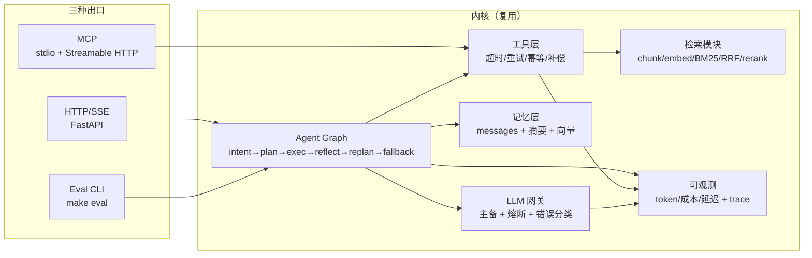
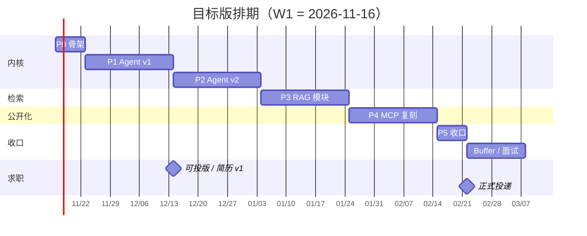

# AI 工程能力补强与求职总规划

> 版本 **v0.8**（精简版）· 2026-11-11 · 状态：待开工（W1 = 2026-11-16）
>
> 原规划原文见 [00-original-plan.md](00-original-plan.md)（未删改，仅作对照）。
> 内网素材归档见 [internal/](internal/README.md)；公开化方案见 [02-mcp-open-source.md](02-mcp-open-source.md)。

---

## 0. TL;DR

1. **目标**：深圳 · 互联网 AI 应用 / Agent 平台 · 双休 · **年包 ≥ 34w**（现薪 17k×12 ≈ 20.4w，+67%）。
2. **关键换算**：**34w = 22.7k × 15 薪**。难点不在"谈高 base"，在"进水位数高的公司"；12 薪公司要 28.3k 才算达标。
3. **资产结构**：1 个内网深度案例（案例 A）+ 1 个可公开项目（案例 B）+ 1 个新造的公开仓库（Agent 平台）。
4. **顺序**：Agent 内核优先；RAG 降级为模块；MCP 不重写，改为**机制复刻**。
5. **最大杠杆**：内网案例的脱敏讲法 + 一个能跑出数字的公开仓库 + 内推。**不是**项目数量。

---

## 1. 目标与约束

| 维度 | 现状 | 约束 |
|---|---|---|
| 学历 | 211 本硕 | 大厂学历关能过 |
| 在职 | 比亚迪 · AI 应用开发 · 1.5 年 | 有真实落地，但"车企"标签要主动弱化 |
| 现薪 | 17k×12 ≈ 20.4w | 现职 5:30 下班、基本不加班 → **时薪 98 元/h，换工作要算时薪** |
| 目标 | 年包 ≥ 34w · 深圳 · 双休 | 三条同时满足 → 可选池很小（约 5–6 家） |
| 时间 | 10h/周（下班后） | 车企节奏下可能只有 6–8h；连续 2 周 < 6h 就降档 |
| 投递 | 2027-02（金三银四） | 现在到投递有约 14 周，不必压缩 |
| 可公开物料 | 内网代码不可搬出 | 一律机制复刻（[AGENTS.md](../AGENTS.md) 第 4 条） |

---

## 2. 对原规划的结论

> 逐条评估已压缩；原文与完整判断见 [00-original-plan.md](00-original-plan.md)。

| 原条目 | 结论 | 理由（一句话） |
|---|---|---|
| Agent：LangGraph 六态图 | **保留** | 核心卖点；重规划分支是高频追问点 |
| 5 个工具（含副作用） | **改** | 3 真 + 2 mock；重点做幂等、补偿、人工确认 |
| SSE 四类事件 | **保留** | 注意 `X-Accel-Buffering: no`、keep-alive、断线重连 |
| 短/长记忆 + 摘要压缩 | **保留** | 向量库本地即可，别上集群 |
| 30 条评测，3 臂对比 | **改 + 加** | 必须加第 4 臂「原生 function calling 直连」，只打 ReAct 是打稻草人 |
| 模型降级 | **保留 + 加** | 加熔断与错误分类（可重试 vs 不可重试） |
| RAG 36 组矩阵 | **保留** | 建库只需 6 次（chunk×emb）；补 RRF 调参与分层 Recall |
| 50 条中文 query | **改** | 纯人力 10–14h；必须打类型标签（事实/比较/多跳/否定/长尾） |
| Recall@5 / MRR / P50 | **改** | 补 **P95** + 延迟三段分解（embed/search/rerank） |
| MCP：5 个代码分析工具 | **砍** | 已有 1.4 万行真项目，再写玩具工具是降级 |
| stdio + **SSE** 双 transport | **改** | HTTP+SSE 自 MCP `2025-03-26` 已废弃 → **Streamable HTTP** |
| MCP 用 FastMCP SDK | **改** | 实际用官方 SDK；"为什么不用 FastMCP"本身就是好答案 |
| src ≤ 1500 行 | **改** | 核心链路 ≤ 800 行；测试与 eval 不计入（原规则会逼你砍评测） |
| 不做前端 / DB / Redis | **保留** | 但**要加 CI + 一键 docker**，性价比最高 |
| 7 周排期 | **砍** | 实际 260–300h；现按 16 周排到 2027-02 |
| 学习路径 10 仓库等权 | **砍到 4 精读 + 6 略读** | 时间算进项目周期，不单独排 |

---

## 3. 五个结构性判断

### 3.1 时间账

原计划 76h 的估算对应 260–300h 的实际工作量（约 4 倍）。现在范围变了（RAG 降级、MCP 改复刻），目标版约 **150–170h @10h/周 ≈ 16 周**，正好卡住 2027-02 投递。

### 3.2 一个内核，三种出口

不是三个 demo，是同一套内核（Agent 图 + 工具层 + 记忆层）分别暴露成 HTTP/SSE、MCP、Eval CLI。省 1/3 工时，且叙事从"我做了三个项目"变成"我建了一个平台并验证了它"。

### 3.3 MCP 不是王牌

2026 年 MCP 已是及格线。你手里有一个真 MCP（案例 A），所以：**内网版讲真实约束下的取舍，公开版做机制复刻**，不再从零写。

### 3.4 投递节奏

**W15（2027-02-22）正式投**，W5–W14 做轻接触（内推、猎头、模拟面试，不正式投）。目标是在投递前攒够 **5 个有效内推**——1.5 年最大的筛子是年限，内推是唯一能绕过去的路径。

### 3.5 真正的杠杆

> 内网经验 = 你**在约束下取舍过什么**（信用）
> 公开仓库 = 你**能独立交付到什么标准**（证据）

两者缺一不可。案例 A 补信用，案例 B + Agent 平台补证据。

---

## 4. 岗位与薪资

### 4.1 赛道：互联网，不是车企

| 维度 | 车企 AI 岗 | 互联网 AI 应用岗 |
|---|---|---|
| 岗位实质 | 多做智驾/座舱算法，与你的经验不连续 | Agent 平台 / AI 应用 / 内部工具，高度连续 |
| 你的经验 | 折价 | 溢价（"做过企业级落地 + 全链路交付"） |
| 2026 态势 | 收缩降本 | AI 应用侧扩招 |

> 简历通篇不出现"汽车/制造"，只写"企业级 AI 应用"。

### 4.2 薪资账：先算年包，再算时薪

| 情形 | base | 薪数 | 年包 | 相对 20.4w |
|---|---|---|---|---|
| 现在 | 17k | 12 | **20.4w** | —— |
| 大厂常规 | 22k | 15 | 33.0w | +62% |
| **达标** | **22.7k** | **15** | **34.0w** | **+67%** |
| 大厂好 offer | 26k | 16 | 41.6w | +104% |

**34w 在不同薪数下需要的 base**：12 薪 28.3k ｜ 13 薪 26.2k ｜ 14 薪 24.3k ｜ **15 薪 22.7k** ｜ 16 薪 21.3k。

再算时薪（双休 9-6 ≈ 45h/周）：

| 年包 | 时薪 | 时薪涨幅 |
|---|---|---|
| 20.4w（现，40h） | 98 元/h | —— |
| 32w | 137 元/h | +39% |
| **34w** | **145 元/h** | **+48%** |
| 42w（10-9，55h） | 153 元/h | +56% |
| 48w（10-10，60h） | 160 元/h | +63% |

> **从 34w 到 48w，年包 +41%，时薪只 +10%**——多出来的是工时。所以 34w + 双休就是最优解，再往上不划算。

### 4.3 市场区间与年限门槛

| 岗位类型 | 月薪带 | 薪数 | 1.5 年够到？ |
|---|---|---|---|
| Agent 应用算法 | 35–60k | 15–18 | ✗ 要 3 年+ |
| **LLM 应用 / 后端开发** | **15–35k** | **13–14** | ✓ 对口带 |
| AI Agent 开发（工程向） | 18–28k | 14 | ✓ |
| 大模型独角兽 | 30–50w 年包 | —— | △ 要顶会或极强项目 |

**硬卡点**：大厂 Agent 岗 JD 主流写"本科 + 3–5 年"。三个绕法，按优先级：

1. **内推绕 HR 筛**——简历直达团队，年限讨论发生在面试里；
2. **只投 1–3 年 / 经验不限 / 新业务线**；
3. **等价经验叙事**——1.5 年拆成 2–3 个从 0 到 1 的交付，观感接近 2.5 年。

### 4.4 公司池（深圳 · 双休优先）

**A 池 · 主攻（6 家，全部内推）**

| 公司 | 年包 | 作息（需自验，见 §4.7） |
|---|---|---|
| 招银网络科技 | 28–38w | 银行作息、双休；上线期忙 |
| 顺丰科技 | 28–36w | 互联网中等强度 |
| 富途 | 32–42w | 中上强度、双休 |
| 虾皮 Shopee | 30–38w | 弹性不打卡；平时 6–7 点，冲 GMV 期到 9–10 点 |
| 腾讯（选组） | 38–48w | 多数 BG 10-9，有好组 9-6 |
| 货拉拉 | 28–36w | 待验证 |

**B 池 · 仅作谈判筹码（4 家，全部低于 34w）**：金蝶 22–32w、明源云 22–30w、外企研发中心 25–38w、国企数字化 18–26w。**不要真去**——去了等于用 WLB 换掉涨薪。

**C 池 · 排除**：微众（董事长要求"卷起来"、部分组强制单休）、平安（组织调整 + 强度大）、字节 / 华为（强度冲突）、大疆 / 优必选 / 中兴 / 云天励飞（偏 CV/算法，不匹配）。

**D 池 · 异地（仅在愿意破例时）**：阿里淘天（杭州，最对口但卷）、得物（上海/杭州）、金山办公 WPS AI（北京/珠海，异地中最可能双休）。

> 加"双休"后，"深圳 vs 异地"不再是主要矛盾——北京上海一样卷。真正的分界是 **互联网 vs 银行科技/外企/企业软件**。

### 4.5 硬线：年包 ≥ 34w

| 档位 | 去向 | 年包 | 判断 |
|---|---|---|---|
| **达标** | 招行 / 顺丰 / 富途 / 虾皮 / 腾讯好组 | 34–38w | 这才是值得跳的区间 |
| 理想 | 同上高配 | 38–42w | 需 2 个 offer 竞价 |
| 放弃区 | 金蝶类 / 国企 / 12 薪给不到 28.3k | < 34w | **不接** |

**未达标预案（先定好，别临场软化）**

| 预案 | 触发 | 代价 |
|---|---|---|
| 延到 2027 下半年 | 首轮全 < 34w 且准备不足 | 晚半年，项目能做深 |
| 接受 1 个异地 | 深圳池投完无达标 | 换城市，阿里/得物能到 38w+ |
| 弃双休换 40w+ | 能接受忙季 | 时薪与 34w 双休相近，**不划算，最后才选** |
| 不跳 | 市场确实给不到 | 天花板明确 |

**决策规则（写死）**：**< 34w 不接，不因为"面了 3 个月"而软化。**

**谈薪六条**

1. 只报年包，不报月薪；2. 先问"带宽和薪数"，拿到 15 薪等于多 25%；3. 报 **35–38w**，下限会被当成接受线；4. base 谈不动谈签字费，但**签字费只补首年**，别用它把 31w 伪装成 34w；5. 把作息当谈判项，能写进 offer 的写；6. 至少 2 个 offer 并行。

### 4.6 能力矩阵

| 能力 | 要求 | 你的证据 | 缺口 |
|---|---|---|---|
| LLM 应用端到端 | 独立扛到上线 | 内网 1.5 年 ✅ | 不可公开 → 脱敏案例 |
| Agent 编排 / 有副作用系统 | 幂等、未知结果、人工确认 | **案例 A 已证明** ✅ | 需要"能讲清"（§11.2） |
| 判定与评测方法论 | 基线、一致性、降级 | **案例 B 已证明**（待补一致性数据） | 缺 golden set 数字 |
| 工程化（可观测/成本/降级） | P95、token 成本、熔断 | 案例 A 强、Agent 平台待做 | 缺量化表 |
| 检索实验 | chunk/emb/混合/rerank 取舍 | **弱** | RAG 模块 + 消融 |
| 后端基本功 | asyncio / FastAPI / SSE | 中 | 八股（§11.3） |
| **可验证性** | 公开代码 + 数字 | **最短板** | 案例 B 开源 + Agent 平台 |

### 4.7 怎么验证一家公司加不加班

**面试反问（问具体，别问"加班多吗"）**

| 无效 | 有效 |
|---|---|
| 加班多吗 | 团队通常几点走？最晚一次几点、因为什么？ |
| 是双休吗 | 周末要处理线上问题吗？最近三个月有几个周末在干活？ |
| 强度大吗 | 上个版本上线前连续加班几天？ |
| —— | 直属 leader 是谁、团队几个人？（组比公司重要 10 倍） |
| —— | 如果我想 6 点下班，团队会怎么看？ |

**硬证据**：晚 8:30 看楼下亮灯率（>70% 别去）；脉脉/看准搜"公司名+加班/单休"，只看近 12 个月；问"这个组近一年走了几个人"。

**红线（踩一条就放弃）**：单休 / 大小周 / "弹性工作制"（实为随时待命）；日报 / 工时统计 / 加班排名；面试安排在晚 9 点后或周末。

**兜底**：试用期观察，保留退路；作息写进书面沟通。

---

## 5. 目标系统架构



| 模块 | 职责 | 边界 |
|---|---|---|
| Agent Graph | 状态流转、重规划、终止条件 | 不直接调工具 |
| 工具层 | schema、超时重试、幂等、补偿、故障注入 | 不写业务逻辑 |
| 记忆层 | 短期窗口、摘要压缩、长期检索 | 不做多租户 |
| 检索模块 | 可插拔 chunk/embed/retrieval/rerank | 不依赖外部 RAG 产品 |
| LLM 网关 | 主备切换、熔断、错误分类、计量 | 不引重型 router |
| 可观测 | 步数/token/成本/延迟 + 可回放 trace | 不做全套 APM |

---

## 6. 排期

### 6.1 三档

| 档 | 工时 | 交付 | 周期 |
|---|---|---|---|
| 最低可投 | 40–50h | 内核 + SSE + 3 工具 + 12 条评测 + 文档录屏 | 4–5 周 |
| **目标版** | **150–170h** | 上述 + 记忆/降级/故障注入 + 30 条评测 + 成本表 + RAG 模块 + MCP 复刻 + 2 篇博客 | **16 周** |
| 理想版 | 220–260h | 再加成本看板、trace 回放 UI | 不推荐 |

**降档触发**：连续 2 周 < 6h → 降到最低可投版；单项目超期 50% → 强制收口。

### 6.2 阶段与 Gate

| 阶段 | 周 | 产出 | Gate |
|---|---|---|---|
| **P0 骨架** | W1 | LLM 网关 + SSE + trace + eval harness + Makefile + CI | 能 `make demo` |
| **P1 Agent v1** | W2–W4 | 图 + 3 工具 + SSE + 12 条评测 | **Gate 1：可投版 + 简历 v1** |
| **P2 Agent v2** | W5–W7 | 记忆/降级/故障注入/30 条评测/成本表 | **Gate 2：数字表可贴简历** |
| **P3 RAG 模块** | W8–W10 | 语料 + 30 query + 12 组消融（不单开仓库） | 3 条反直觉结论 |
| **P4 MCP 复刻** | W11–W13 | 假后端 + 三阶段确认 + 四态 + 有界等待 + 测试 | `make demo` 可跑 + 授权结论明确 |
| **P5 收口** | W14 | README 终稿、2 篇博客、简历终稿 | 谈薪素材齐 |
| **正式投递** | **W15（2027-02-22）** | 深圳 A 池 6 家 + B 池备选 | —— |



### 6.3 Gate 定义

**Gate 1（W4 末）**：`make demo` 起服务、`curl` 见 4 类 SSE 事件；`make eval` 跑 2 臂 × 12 用例出表；3 工具可用且 1 个带幂等；README 顶部 3 行 + 数字表；简历 v1 完成。

**Gate 2（W7 末）**：4 臂 × 30 用例 × 3 seeds 跑完（均值±std）；切断主模型能自动切备用；故障注入下成功率衰减可量化；成本/延迟表；5 个 ADR；1 分钟录屏。

---

## 7. DoD 与评测设计

### 7.1 通用 DoD（每个公开仓库）

- `make demo` / `make eval` / `make up` 可用
- README 顶部 3 行：做什么 + 关键数字 + 怎么跑
- `docs/decisions.md` ≥ 5 条 ADR（每条写明否定了什么方案）
- 架构图 + **失败路径图**
- 评测表带方差与样本量
- 1 分钟录屏
- CI 跑评测子集（≥ 5 条）
- 无明文密钥（`.env.example` + 启动校验）

### 7.2 Agent 评测

**四臂**（同模型、同工具、同 prompt 预算）：A 单 prompt ｜ B ReAct ｜ **C 原生 function calling** ｜ D 自研图。

> C 才是主基线。打不赢裸 FC 循环，就没有故事——诚实对比反而加分。

**30 条分层**：L1 单工具 8 ｜ L2 多工具 8 ｜ L3 需重规划 6 ｜ L4 应拒答/澄清 4 ｜ L5 故障注入 4。

**指标**：成功率（3 seeds 均值±std）、平均步数、**每成功任务 token 成本**、P50/P95、工具错误率、重规划次数。

**判分**：确定性用例规则判；开放用例 LLM judge（固定模型 + rubric + 20% 人工抽检一致率 ≥ 85%）。**防作弊**：用例不进 prompt、temperature 固定、judge 与待测不同家族。

### 7.3 RAG 模块

**语料**：抓 3–5 个开源项目中文官方文档（200–500 篇），许可清晰。
**矩阵**：chunk(256/512/semantic) × emb(2) × 检索(向量/BM25/RRF) × rerank(有/无) = 36 组，但建库只需 6 次，务必缓存。目标版缩到 **12 组**。
**Query**：30 条（20 人工 + 10 半自动 + 全量校验），标 ground truth chunk ids + 类型标签。
**指标**：Recall@5、MRR@10、P50/P95、延迟三段分解、索引体积。
**分析**：按 query 类型分层、chunk 边际收益、RRF 的 k 敏感性、rerank 性价比。**要求讲出 3 条反直觉结论。**

### 7.4 MCP 复刻版

保留 5 个机制：① 计划—确认—执行三阶段（确认绑定账号+配置+产物摘要）② 四态结果 + 未知不重试 ③ 确定性规则下沉 ④ 有界等待与预算 ⑤ 记录/锁/恢复。

补充：`DeploymentBackend` 协议 + 本地假后端、stdio + **Streamable HTTP**、API Key + 限流 + 审计日志、工具描述即 prompt、错误码区分可重试。

详见 [02-mcp-open-source.md](02-mcp-open-source.md)。

---

## 8. 版本与选型风险

| 组件 | 选择 | 风险与对策 |
|---|---|---|
| MCP 传输 | Streamable HTTP + stdio | ⚠️ HTTP+SSE 自 `2025-03-26` 废弃；`2026-07-28` 移除 GET 流与协议级 session → 以官方 spec 为准 |
| FastMCP | 不用，用官方 SDK | 若用则 pin v3；v2 写法大量弃用 |
| LangGraph | pin 版本 | checkpointer/store API 变过，升级前跑 `make eval` 回归 |
| SSE | `sse-starlette` 或手写 | `X-Accel-Buffering: no`、keep-alive 注释行 |
| 模型 | 主：国内可用主力；备：另一家 | 自写 100 行网关即可；**别为降级引入 LiteLLM** |
| Embedding / Rerank | 本地 bge 系列 | 两个 embedding 若一 API 一本地，**只能比 Recall，不能比延迟** |
| 观测 | jsonl trace 起步 | 可选 Langfuse，别让观测吃掉一周 |

**三条硬规则**：所有依赖 pin；协议类决策以官方 spec 为准而非博客；每个"读源码得出的结论"在 ADR 注明来源与日期。

---

## 9. 学习路径（4 精读 + 6 略读，共约 34h）

| # | 仓库 | 模式 | 时间盒 | 必须回答 |
|---|---|---|---|---|
| 1 | smolagents | 精读 | 6h | 为什么这么少代码能跑？工具失败怎么处理？记忆边界在哪？ |
| 2 | FastMCP + mcp/servers | 边写边读 | 4h | schema 从哪来？鉴权插在哪层？stdio 与 HTTP 生命周期差异？ |
| 3 | LangGraph examples | 精读 3 个 | 8h | state 怎么合并？checkpoint 存什么？中断恢复靠什么？ |
| 4 | LiteLLM | 略读 | 2h | 重试与熔断在哪层？错误怎么分类？ |
| 5 | RAGFlow（只看文档） | 略读 | 3h | 几种切分？语义切分的触发条件？表格/代码怎么处理？ |
| 6 | Langfuse | 略读 | 3h | span/generation 怎么嵌套？评测怎么挂到 trace？ |
| 7 | Letta | 略读 | 2h | 长期记忆怎么摘要？怎么防污染？ |
| 8 | Pydantic AI | 略读 | 2h | 校验失败怎么重试？ |
| 9 | Haystack | 略读 | 1h | 组件契约是什么？ |
| 10 | Dify（只看 `api/core/`） | 略读 | 3h | 节点间数据怎么传？ |

**纪律**：打开代码前先写 3 个问题；到点没答完也停。笔记只写"它怎么解决某个问题 + 我会不会这么做 + 为什么"。

---

## 10. 风险与止损

| # | 风险 | 概率 | 影响 | 信号 | 应对 |
|---|---|---|---|---|---|
| R1 | 工时不达标 | 高 | 高 | 连续 2 周 < 6h | 降档，周期拉到 20 周 |
| R2 | 范围蔓延 | 高 | 中 | 核心逻辑 > 800 行 | 砍功能进 backlog |
| R3 | 完美主义耗在录屏/README | 中 | 中 | 单项文档 > 3h | 硬上限 2h，先出粗糙版 |
| R4 | 面试连续受挫 | 中 | 中 | 3 场挂同类问题 | 停投 1 周专项补 |
| R5 | 叙事不聚焦 | 中 | 高 | 面试官问"这些项目啥关系" | 用 §5 图回答"一内核三出口" |
| R6 | 用了过期技术资料 | 中 | 中 | 面试官纠正 MCP 传输 | 协议类一律查 spec |
| R7 | 只做不收口 | 中 | 高 | W14 还没有终稿 README | 强制收口周，禁开新功能 |

**止损四条**：连续 2 周未达标 → 砍范围不延期；单项目超期 50% → 强制收口；拿到 1 个达标 offer → 减速开发转谈薪；健康/家庭事件 → 直接跳 buffer。

---

## 11. 求职执行清单

### 11.1 简历结构（一页）

1. 抬头：姓名 / 211 本硕 / 比亚迪 AI 应用开发 / 方向（AI 应用 · Agent 平台 · LLM 工程）
2. 核心能力 3 行：LLM 应用工程化 · Agent 编排与评测 · RAG 检索实验
3. **项目 A：内网建站 MCP（脱敏）**——业务、角色、架构、4 个数字
4. **项目 B：SkillScan TRACE（开源）**——判定与一致性数字
5. 项目 C：Agent 平台（开源）——成功率/成本/P95
6. 技术栈 + 博客链接 + 教育

> 内网在前（信用），开源在后（证据）。通篇不出现"汽车/制造"。

### 11.2 内网案例讲法（STAR + 指标）

```
背景：什么业务｜规模（量级表述）｜原方案痛点
角色：独立全链路 / 主导 / 参与 —— 诚实
方案：脱敏架构图 + 3 个关键决策 + 每个决策否定了什么
结果：4 个数字（效果 / 成本 / 延迟 P95 / 稳定性）
反思：如果重做会改什么
```

**禁区**：客户名、数据样例、内部系统名、精确指标、可反推业务的细节。数字用"约 / 量级 / 相对提升"表述。

**话术陷阱**：被问"你做过什么 AI"，忌答"我做了个内网建站工具"（被判业务集成）。要直接讲机制——"我处理 Agent 有副作用时的未知结果：拆成四个状态，未知就停，绝不重试"。

### 11.3 八股与系统设计

| 板块 | 必刷 |
|---|---|
| Python | GIL、asyncio 事件循环、协程 vs 线程、生成器、装饰器、GC |
| 后端 | FastAPI 依赖注入/中间件/生命周期、SSE vs WebSocket、超时重试、幂等 |
| 数据 | B+ 树 vs 倒排、HNSW 的 `m`/`ef`、BM25 公式 |
| LLM | tokenizer、temperature/top_p、上下文截断、function calling 原理、结构化输出、幻觉成因、评测方法 |
| 系统设计 | ① 企业知识库问答 ② 高并发 Agent 网关 ③ 评测平台 |
| 算法 | 大厂会手撕，每周 2 题维持手感 |

### 11.4 时间线

| 周 | 动作 |
|---|---|
| W4 | 简历 v1，给 1–2 个同行看 |
| W5–W14 | 轻接触：内推沟通、猎头、2–3 场模拟面试（**不正式投**） |
| W15 | 正式投递：A 池 6 家全内推 |
| W16+ | 每周复盘：挂在哪类问题 → 下周优先补 |
| 拿到 1 个 offer | 减速开发，全力备面 + 谈薪 + 造第二个 offer |

### 11.5 年限卡点的应对

内推优先（目标 5 个有效内推）> 只投 1–3 年岗 > 等价经验叙事 > 面试前先发仓库链接让对按能力评估。

---

## 12. 下一步（本周）

1. **投喂案例 A 的三个坑**（§7），我整理成面试话术。
2. **盘深圳内推渠道**：校友群、前同事、脉脉、技术社群，先拿 2 个。
3. **建 P0 骨架**：LLM 网关 + SSE + trace + eval harness + Makefile（W1 开工）。
4. **定语料来源**：默认抓 3–5 个开源项目中文文档。
5. **定模型与预算**：主备各一个，设月度 API 上限（评测跑批是大头）。

---

## 附录 · 变更日志

| 版本 | 变更 |
|---|---|
| v0.1 | 初版：原规划评估、结构性判断、排期、DoD 与风险册 |
| v0.2 | 引入**年包**口径；赛道由车企改为互联网；新增市场薪资带与年限绕法 |
| v0.3 | 加入**深圳**硬约束，重排公司池 |
| v0.4 | 加入**双休**硬约束，引入时薪视角；更正微众/虾皮/平安；补加班验证清单 |
| v0.5 | 归档内网建站 MCP（案例 A）→ 取消"从零写 MCP"，P4 改为机制复刻；RAG 降为模块 |
| v0.6 | 确认案例 A 独立全链路负责；公开路线定稿为机制复刻并写入 AGENTS.md |
| v0.7 | 目标改为**硬线 34w**，补未达标预案与决策规则 |
| v0.8 | 新增案例 B（SkillScan）评估与待办；**全文精简**（749 → 约 400 行），删除重复与过时内容 |
