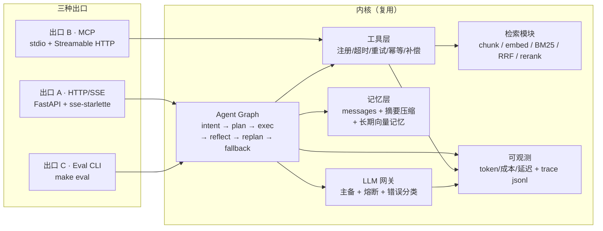
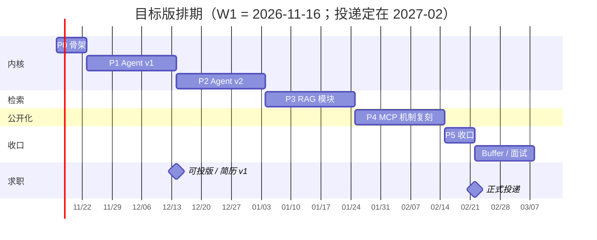

# AI 工程能力补强与求职总规划

> 版本 **v0.1** · 2026-11-10 · 状态：**待执行**
>
> 本文档 = 原规划留存 + 逐条评估 + 修正方案 + 执行清单。
> 原规划原文见 [00-original-plan.md](00-original-plan.md)，未做删改，用于对照。
> 内网项目素材按 [internal/README.md](internal/README.md) 的模板投喂。

---

## 0. TL;DR

1. **目标**：211 本硕 + 1.5 年（比亚迪「AI 应用开发工程师」，现薪 17k×12 ≈ **20.4w**）→ **年包 34–42w**，在**深圳**跳互联网的 AI 应用 / Agent 平台团队。**关键换算：大厂 15 薪下 base 23k 即 34.5w，已超过"28k×12 = 33.6w"——所以要盯年包，不是盯 base。**
2. **原规划方向是对的**：评测驱动、约束清晰、拒绝全家桶、每个仓库有数字结果——这套审美比大多数人的 side project 高。
3. **成本算错了 3.5–4 倍**：70 小时的计划实际 260–300 小时，@10h/周 ≈ 5–6 个月，不是 7 周。
4. **最大结构性修正**：三个互不相干的仓库 → **一个内核、三种出口**（HTTP/SSE、MCP、Eval CLI）。开发省约 1/3，叙事从"三个 tutorial demo"变成"一个可验证的平台"。
5. **顺序修正**：Agent 内核优先；**MCP 最后做薄封装**——2026 年 MCP 已是及格线，不是差异化王牌，不该吃掉最贵的时间。
6. **技术事实修正**：MCP 的 SSE 传输**已废弃**，现行是 **Streamable HTTP**；FastMCP 已到 **v3**；LangGraph 必须 pin 版本。
7. **节奏**：按你的选择，**第 7 周末正式投递**（第 4 周末先出可投版）。
8. **杠杆不在仓库数量**，在：内网项目的脱敏案例 + 一张能贴进简历的数字表 + 面试表现 + 谈薪节奏。

---

## 1. 目标与约束

| 维度 | 现状 | 对规划的约束 |
|---|---|---|
| 学历 | 211 本硕 | 大厂学历关基本能过；卡 985 的岗位会被筛，但面宽足够 |
| 在职 | 比亚迪 · AI 应用开发工程师 · 1.5 年 | 简历筛选不减分（上市公司体量背书）；但不是"AI 强背书"，需要项目补 |
| 目标薪资 | 现薪 17k×12 ≈ 20.4w/年 → 目标**年包 34–42w** | 涨幅约 +67%～+106%，属**跳级**而非普通跳槽；须靠"可验证深度 + 多 offer 竞价 + 年包谈判" |
| 城市 | **深圳（硬约束）** | 可选池缩小约一半：深圳 AI 应用岗以**腾讯 + 金融科技（微众/平安/招行）+ 物流（顺丰/货拉拉）+ 企业软件（金蝶）**为主；"AI 应用/Agent 平台"这类新岗密度显著低于北京、上海、杭州。见 §4.4 |
| 时间投入 | 每天 2h × 5 天 = 10h/周 | **这是最脆弱的假设**。比亚迪工作强度大，实际可能只有 6–8h/周 |
| 可公开物料 | 内网代码 **不可搬出** | 只能"重建核心链路 + 脱敏讲架构"；公开仓库是唯一硬证据 |
| 求职方向 | 深圳 · 互联网 AI 应用 / Agent 平台 | 见 §4.1 赛道与 §4.4 公司清单 |

> ⚠️ **第一个风险不是技术，是工时**。比亚迪的节奏下 10h/周很可能保不住。本文档按 10h/周 排期，同时在 §6.1 给了降档预案——**一旦连续两周低于 6h，立刻降档，不要延期**。

---

## 2. 原规划逐条评估

判断标记：**保留**（照做）· **改**（方向对，做法调整）· **砍**（不做）· **加**（原规划缺的关键项）

### 2.1 Agent 平台

| 原条目 | 判断 | 说明 |
|---|---|---|
| LangGraph 状态图（intent/plan/tool-exec/reflect/replan/fallback） | **保留** | 这是核心卖点，状态机的"重规划"分支是面试高频追问点 |
| 5 个工具（含副作用）+ 重试 + 降级 | **改** | 3 个真工具 + 2 个 mock。**工具数量不稀缺，副作用一致性才稀缺**：把重点放在幂等键、人工确认、补偿回滚 |
| SSE 四类事件（thinking/tool_call/tool_result/answer） | **保留** | 注意 `X-Accel-Buffering: no`、keep-alive 注释行、断线重连 |
| 短记忆 + 长记忆（向量库）+ 摘要压缩 | **保留** | 但长记忆用本地向量库（sqlite/numpy 或 chroma）即可，别上 Qdrant 集群 |
| 30 条评测，对比"单 prompt vs ReAct vs 自研图" | **改 + 加** | 见 §7.2：**必须加第 4 臂「原生 function calling 直连」**。只打 ReAct 是打稻草人，真正该赢的基线是裸工具循环 |
| 模型降级（主挂切备） | **保留 + 加** | 加**熔断 + 错误分类**（可重试/不可重试）；国内网络环境本身就是天然演示场景 |
| —— | **加** | **成本与延迟账**：每次运行记录 token/成本/步数/P95，这是拉开薪资档位的指标 |
| —— | **加** | **工具故障注入**（mock 工具 50% 超时），验证降级路径真的生效 |
| —— | **加** | **Trace 落盘**（jsonl 起步，可选 Langfuse），能回放一次失败运行 |

### 2.2 RAG 评测系统

| 原条目 | 判断 | 说明 |
|---|---|---|
| 不部署 RAGFlow，自己写核心链路 | **保留** | 正确。部署开源产品学不到链路细节 |
| 矩阵 chunk(256/512/semantic) × emb(2) × 检索(3) × rerank(2) | **保留** | 3×2×3×2 = 36 组可跑；注意**建库只需 6 次**（chunk×emb），别重复建 |
| 50 条中文 query + ground truth | **改** | 这是**纯人力 10–14h**，最容易被低估。做法见 §7.3：20 人工 + 30 半自动 + 全量人工校验，且必须打**类型标签** |
| 指标 Recall@5 / MRR / P50 | **改** | 补 **P95**（P50 会掩盖长尾）+ **延迟三段分解**（embed / search / rerank）+ nDCG@10（可选） |
| 接入 Agent 作为检索工具 | **保留** | 这是"一内核三出口"的粘合点，也是复用的关键 |
| —— | **加** | **RRF 权重敏感性**（混合检索的 k 值），比单纯"混合 vs 向量"有洞察 |
| —— | **加** | **分层分析**：按 query 类型（事实/比较/多跳/否定/长尾）看哪一类掉点 |
| —— | **加** | **语料来源与许可**必须写清（合规 + 可复现），见 §7.3 |

### 2.3 MCP 建站

> **重要更新（v0.5）**：这一项**不需要从零做**。你已有一个内网建站 MCP（70 模块 / 1.4 万行 / 161 次提交），能力远超原规划的"5 个代码分析工具"。原条目改为"把它公开化"，见 [02-mcp-open-source.md](02-mcp-open-source.md)。

| 原条目 | 判断 | 说明 |
|---|---|---|
| FastMCP SDK + 5 个真实工具（代码分析类） | **砍** | 已在真实项目里用了官方 MCP SDK（低层）。再写 5 个玩具工具是**降级**——面试官聊两句就看出来。反过来，"为什么不用 FastMCP"是个好答案 |
| API Key + 限流 + 审计日志 | **改** | 原项目是本地 stdio、无鉴权（权限交给平台）。公开版要补：API Key 常量时间比较、按 key 限流、审计字段 |
| stdio + **SSE** 双 transport | **改** | ⚠️ HTTP+SSE 自 MCP `2025-03-26` 起已废弃，现行 **Streamable HTTP**；`2026-07-28` 修订移除 GET 流与协议级 session（见 §8）。原项目只有 stdio，公开版正好补齐这一课 |
| 能被 Claude Desktop 直接接入 | **保留** | 5 分钟接入指南 + 录屏 |
| —— | **加** | **工具描述即 prompt**：写清何时用/何时不用/参数示例/返回结构 |
| —— | **加** | **错误码约定 + 幂等**：可重试 vs 不可重试 |
| **定位** | **改（再次）** | 不是"分发层"，而是**"内网深度案例 × 公开机制复刻"双份资产**：内网版证明真实约束下的取舍，公开版提供可验证代码 |

### 2.4 技术栈原则

| 原条目 | 判断 | 说明 |
|---|---|---|
| 不用 RuoYi / full-fastapi-template | **保留** | 正确，模板会带来无意义的面试噪音 |
| FastAPI 裸写 + pydantic-settings + langgraph + httpx | **保留** | 建议补：`tenacity`（重试）、`sse-starlette`（SSE）、`pytest`（评测） |
| MCP 用 FastMCP SDK | **保留** | pin 到具体小版本，README 注明"基于 FastMCP vX" |
| 每个项目 src ≤ 1500 行 | **改** | 改成 **核心链路 ≤ 800 行，测试与 eval 代码不计入**。行数是虚荣指标，按原规则会逼你砍掉最有价值的评测代码 |
| API Key + 一行 Depends，不要 RBAC | **保留** | 正确，RBAC 是纯成本 |

### 2.5 不做的事

| 原条目 | 判断 | 说明 |
|---|---|---|
| 不做多租户 | **保留** | 面试现场能讲清"如何加租户"即可 |
| 不做前端管理后台 | **保留** | 但要有**一个能看的界面**：终端 `curl` + 录屏足够，别做 React |
| 不引入 LangChain 全家桶 | **保留** | LangGraph 是图运行时，不算全家桶；但**生态包别顺手装** |
| 不加 DB 迁移 / Redis 队列 | **保留** | 手动 DDL + 内存队列够用 |
| —— | **加** | 但**要加 CI**（PR 跑评测子集）+ **一键 Docker**。这两个"工程化"信号的性价比远高于上面砍掉的所有东西 |

### 2.6 每个仓库必须有

| 原条目 | 判断 | 说明 |
|---|---|---|
| README（3 行定位 + 数字结果） | **保留** | 强烈保留，这是最高 ROI 的一条 |
| docs/decisions.md（≥5 ADR） | **保留** | ADR 写"否定了什么"，比写"用了什么"有信息量 |
| 架构图（mermaid） | **保留** | 加一张**失败路径图**（降级时数据怎么走），比正常路径图值钱 |
| 评测结果表 | **保留** | 要带**方差**（3 seeds 均值±std），单次结果不可信 |
| demo GIF / 1 分钟录屏 | **保留** | 用 asciinema + 剪 60s，控制在 2 小时内做完 |
| Makefile（make demo / make eval） | **保留** | 再加 `make up`（docker）和 `make fmt` |

### 2.7 时间线与学习路径

| 原条目 | 判断 | 说明 |
|---|---|---|
| 7 周 = 3 项目 + 博客 | **砍 / 重排** | 算不过来：项目本身 3+2+2=7 周，加博客已 7.4 周，**学习与求职为 0**。真实需 16 周（目标版） |
| MCP 先做（差异化最大） | **改** | 顺序改为：骨架 → Agent → RAG → MCP。理由见 §3.3 |
| 博客 3 天 2 篇 | **保留** | 只写**自己有数据**的：评测方法论、MCP 实战踩坑 |
| 学习路径 10 个仓库等权 | **砍到 4 精读 + 6 略读** | 10 个仓库单独排就是 10 周。必须时间盒，且**时间算进项目周期**（见 §9） |
| 学习方法（跑起来→打断点→架构图→1000 字） | **保留 + 加** | 加一条：**每个仓库先写"我要回答的 3 个问题"再打开代码**，否则会变成漫游 |

---

## 3. 五个结构性判断

### 3.1 时间账：差 3.5–4 倍

| 模块 | 原估 | 重估 | 主要被低估的部分 |
|---|---|---|---|
| Agent 平台 | 30h | **80–100h** | 评测基线与判分口径、长期记忆、观测、录屏 |
| RAG 评测 | 20h | **55–65h** | 50 条 query + ground truth 标注、语义 chunk、36 组跑批 |
| MCP 建站 | 20h | **31–35h** | 工具"要真实"就快不了；鉴权/限流/审计/双 transport 联调 |
| 学习路径 | 0h | **25–30h** | 原规划完全没算这部分 |
| 博客 | 6h | **10h** | 2 篇有数据的长文 |
| 求职本身 | 0h | **60–70h** | 简历 2 版 + 20 场面试 + 每场复盘 |
| **合计** | **76h** | **260–300h** | **≈ 5–6 个月 @ 10h/周** |

结论：**7 周做不完**。要么砍范围（§6.1 降档），要么拉长到 16 周（§6.2）。两者都接受，唯一不能接受的是"按 7 周排期然后崩盘"。

### 3.2 三个项目不是三个故事，是一个系统的三个出口

"Agent + RAG + MCP 三个仓库"在面试官眼里 = 三个跟教程做的 demo，而且会追问"这三个有啥关系"。
改成**一个内核、三种出口**，代码与评测基线复用，**总工时省约 1/3**，且叙事从"我做了三个项目"变成"我建了一个平台并验证了它"：

- **内核**：Agent Graph（intent / plan / exec / reflect / replan / fallback）+ 工具层 + 记忆层
- **出口 A（HTTP/SSE）**：给人用 / 给前端用 → Agent 平台仓库
- **出口 B（MCP）**：给别的 agent 用（Claude Desktop）→ 分发层，薄封装
- **出口 C（Eval CLI）**：给自己用 → 也是简历上最有说服力的那张表

见 §5 架构图。

### 3.3 MCP 的真实定位：分发层，不是王牌

2026 年 MCP 已是**及格线**：SDK 让一个 server 200 行就能跑，人人都有 demo。它的价值在两处：

1. **分发**——让你的真实能力（工具设计、RAG 检索）被别人的 agent 用上；
2. **工具设计方法论**——description 即 prompt、错误码语义、幂等、可观测。这才是稀缺能力。

所以：**不做第一个，做最后一个**。用 2 周把内核的工具"薄封装"出去，而不是花 2 周从零造一个 MCP server 再想它能干嘛。

### 3.4 投递节奏：第 7 周末正式投（你的选择）

你选了"Agent 做完再投"。尊重这个判断——它换来的是"上场时手里有完整作品"，代价是错过 1.5 个月市场窗口。

**折中方案（强烈建议执行）**：
- **W4 末**：产出"可投版"（内核 + SSE + 3 工具 + 12 条评测 + README），简历 v1 定稿；
- **W4–W7**：**不正式投递，但做轻接触**——内推沟通、猎头聊、2–3 场模拟面试、把简历给 1–2 个同行看。目的是**提前拿到市场反馈**，而不是等 W7 才发现叙事有问题；
- **W8 起**：正式投递，同时继续 P3/P4。此时手里"有东西在产出"，面试时反而是加分项。

### 3.5 真正的杠杆：内网经验 > 三个 side project

1.5 年从 20.4w 冲到 34w+，本质是**跳级**（P6 / 高级 / 独角兽核心岗）。这个档位看"你在真实约束下交付过什么、有没有数字"，不是"业余写了几个 demo"。

三个 side project 的作用是**可验证的深度证明**——证明"这人能独立端到端交付，且会做评测"。它**替代不了** 1.5 年真实生产经验，两者的关系是：

> 内网经验 = 你**做错过什么、在约束下取舍过什么**（信用）
> 开源仓库 = 你**能独立交付到什么标准**（证据）

所以内网项目必须变成资产：**脱敏案例归档**（架构图 + 技术决策 + 归一化指标 + 踩坑），不贴任何代码和数据。模板见 [internal/README.md](internal/README.md)。这是本文档里**唯一必须你亲自投喂素材**的部分，也是性价比最高的一部分。

---

## 4. 目标岗位画像与差距（互联网方向）

### 4.1 先纠正赛道：你要去的是互联网，不是车企

你说了两件事：**实际工作更靠近代码开发**、**想跳互联网**。这两条都成立，而且互相支撑：

| 维度 | 车企 AI 岗 | 互联网 AI 应用岗 |
|---|---|---|
| 岗位实质 | 多数是**智驾 / 座舱 / 三电**算法，与"内部 AI 应用开发"经验不连续 | **Agent 平台 / AI 应用 / 内部效率工具**，与你做的事高度连续 |
| 你的经验折算 | 折价（"车企背景不懂互联网"） | 溢价（"做过企业内部落地 + 全链路交付"） |
| 2026 招聘态势 | 收缩、降本、HC 少 | AI 应用侧扩招（例：腾讯混元 2026 年 10–11 月一次放出 60+ 社招岗，见 §4.4） |
| 薪资 | 25–35k，但多为固定 12–14 薪 | 15–16 薪常见，**年包更高** |

> 结论：**放弃车企主攻，改投互联网**。比亚迪在这里的作用是"大厂级体量背书 + 有真实落地经验"，不是"行业对口"。简历上不要写"汽车行业经验"，要写"企业级 AI 应用落地"。

### 4.2 薪资账：把"月薪"换成"年包"（这一节最重要）

你现在的 17k×12 是**隐性低薪**——不是 base 低，是**薪数低**。同样水平的 base，换到 15 薪公司年包直接多 25%。所以真正的目标不该是"base 28k"：

| 情形 | base | 薪数 | 年包 | 相对 20.4w 涨幅 |
|---|---|---|---|---|
| 现在 | 17k | 12 | **20.4w** | —— |
| 你原本的目标 | 28k | 12 | 33.6w | +65% |
| 大厂常规 offer | 22k | 15 | **33.0w** | +62% |
| 大厂常规 offer | 24k | 15 | **36.0w** | +76% |
| 大厂好 offer | 26k | 16 | **41.6w** | +104% |
| 大厂 SP | 28k | 16 | 44.8w | +120% |

> **核心结论**：在 15–16 薪的公司，base **23–26k** 就已经打到你要的"28k 等价年包"。你的主战场是**"能不能进 15 薪以上的公司"**，而不是"能不能谈到 28k base"。这一条能把难度直接降一档。
>
> ⚠️ 但年包 ≠ 到手保证：15/16 薪里通常有 2–4 个月是绩效浮动（0.8–1.2 倍），只认 base 才是稳的。谈判时**先锁 base，再争薪数，最后用签字费补差**。

**第二层：时薪——加上"不加班"之后，这才是真指标**

你现在的"5:30 下班"是一个**很值钱的隐性福利**。同样涨薪，换来的工时不同，性价比天差地别：

| 情形 | 年包 | 周净工时 | 年工时 | **时薪** | 年包涨幅 | 时薪涨幅 |
|---|---|---|---|---|---|---|
| 现在（5:30 走） | 20.4w | 40h | 2080 | **98 元/h** | —— | —— |
| 金蝶 / 外企（双休轻） | 26w | 40h | 2080 | 125 元/h | +27% | +28% |
| 招行 / 顺丰（双休中） | 32w | 45h | 2250 | **142 元/h** | +57% | +45% |
| 虾皮 / 富途（看组） | 36w | 50h | 2500 | 144 元/h | +76% | +47% |
| 腾讯（10-9） | 42w | 55h | 2750 | 153 元/h | +106% | +56% |
| 字节（10-10） | 48w | 60h | 3000 | 160 元/h | +135% | +63% |

> **这张表是本文档最重要的一页**。从"双休中厂"到"字节"，年包多 16w（+50%），但每周多干 15 小时，**时薪只多 12%**。
> 也就是说：**你的涨薪里，很大一部分是"用时间买来的"，不是"单价变高了"。**
> 所以你既然明确"不想太累"，**最优点就是年包 30–34w + 双休 + 9-6**（时薪 +45% 左右）。再往上，每一块钱都要拿周末和晚上去换。

### 4.3 市场区间与"年限门槛"（这是你唯一的硬卡点）

2026 年 5 月抓取的真实 JD 与薪资带（[AI Agent 岗位 JD 研究报告](https://harrisliangsu.github.io/ai-agent-engineer-handbook/interview-prep/html/jd-requirements.html)）：

| 岗位类型 | 月薪带 | 薪数 | 典型公司 | 1.5 年能否够到 |
|---|---|---|---|---|
| Agent 应用算法工程师 | 35–60k | 15–18 | 腾讯混元、蚂蚁 AI Force、智谱 | ✗ 偏算法，要 3 年+ |
| **LLM 应用 / 后端开发** | **15–35k** | **13–14** | 美团、京东、中型厂 | ✓ **这就是你的对口带** |
| AI Agent 开发（工程向） | 18–28k | 14 | 火山引擎 ADG 等 | ✓ 直接对口 |
| 中型厂 AI Agent | 25–35k | 12–14 | 义乌/杭州类公司 | ✓ 但背书弱 |
| 大模型独角兽 | 30–50w 年包 | —— | 月之暗面、智谱、MiniMax | △ 要顶会或极强项目 |

**硬卡点**：大厂 Agent 应用岗 JD 主流写 **"本科 + 3–5 年"**（腾讯混元：本科 + 3 年；字节 Agent 架构师：本科 + 3–5 年）。你 1.5 年，**年限是第一道筛**。三个绕法，按优先级：

1. **内推绕 HR 筛**——简历直达用人团队，年限讨论发生在面试里而非系统里。这是 1.5 年进大厂唯一靠谱的路。
2. **只投"1–3 年 / 经验不限 / 新业务线"的岗**——T2 梯队（垂类、中型）这类岗最多。
3. **用"等价经验"叙事**——把 1.5 年讲成"独立负责过 2–3 个 AI 应用从 0 到 1"，用内网脱敏案例 + 开源仓库把"1.5 年"补成"看起来像 2.5 年"。

### 4.4 目标公司清单（深圳 · 双休优先）

> 硬约束升级为两条：**深圳** + **双休 / 不加班**。加第二条之后池子结构彻底变了——**"给得最多"的几家恰好是"最不能去"的几家**。
> 作息一栏 = 坊间信息 + 公开报道，**不是承诺**；入职前必须自己验证（方法见 §4.7）。年包为估算，命中概率是我的判断。

**A 池 · 主攻：双休 + 中等强度 + 年包 30–38w（6 家）**

| 公司 / 方向 | 年包 | 作息（需你验证） | 说明 |
|---|---|---|---|
| **招银网络科技 · AI 应用 / 智能投顾** | 28–38w | 银行作息、双休；**项目上线期会忙** | 「双休 × 给得起」的最优交点；**年终占比高**，base 谈得低也能补回来 |
| **顺丰科技 · 物流 AI / 智能调度 / Agent** | 28–36w | 互联网中等强度 | 业务落地重、工程味浓，和你现在做的事最像 |
| **富途 · 金融 AI / 智能投研** | 32–42w | 中上强度、双休 | 港美股金融科技，技术栈现代；强度必须问清 |
| **Shopee 虾皮（深圳）· 跨境 AI 应用** | 30–38w | **弹性不打卡；平时 6–7 点走，冲 GMV / 大促期到 9–10 点**（[论坛反馈一](https://ask.cocoloop.cn/questions/10010000000116529)、[二](https://ask.cocoloop.cn/questions/10010000000077485)） | **看组**：一线业务（供应链/招商）比中后台忙得多。AI 应用多在中后台，相对可接受；英语要过 |
| **腾讯（选组）· 元宝 / WorkBuddy / 腾讯云 AI** | 38–48w | **多数 BG 10-9，但有组 9-6** | 深圳最对口、给最多，但"能不能选到好组"是**运气**——没拿到具体组和汇报线之前，别为它放弃别的 offer |
| **货拉拉 · 智能调度 / AI 应用** | 28–36w | 互联网强度，需验证 | 深圳本地、业务密度高 |

**B 池 · 生活质量优先：双休 + 轻 + 22–32w（4 家）**

| 公司 / 方向 | 年包 | 作息 | 说明 |
|---|---|---|---|
| **金蝶 · 苍穹/星瀚 AI（企业 SaaS）** | 22–32w | 传统软件作息、双休、加班少 | **与你"企业内部 AI 应用 + 知识库"经验最同构**，命中率全表最高；代价是薪资 |
| **明源云 · 地产 SaaS AI** | 22–30w | 双休 | 行业下行、HC 少，当备选 |
| **外企研发中心（汇丰科技 / 渣打 / 亚马逊等深圳点）** | 25–38w | 普遍双休、少加班 | **WLB 最好的档**；但要先确认深圳点是否真有 AI 应用岗（不少在外包/运维线） |
| **国企数字化（招商局 / 中电科系）** | 18–26w | 双休、稳定 | 涨薪幅度小，只在"生活质量绝对优先"时才考虑 |

**C 池 · 排除：给得多，但与你的诉求直接冲突（含重要更正）**

| 公司 | 上一版的判断 | 更正后 | 依据 |
|---|---|---|---|
| **微众银行** | "节奏慢于互联网" | **排除**：董事长公开要求全员"卷起来"，部分项目组**强制单休**、常晚 10 点下班 | [2024-12 报道](https://wap.zhengguannews.cn/html/zgh/300045.html) |
| **平安科技 / 金融壹账通** | "门槛相对友好" | **排除**：组织调整频繁 + 强度大 | 公开信息 |
| **字节（深圳）/ 华为** | "主攻" | **排除**：强度与你"5:30 下班"的现状差距过大 | 行业共识 |
| 大疆 / 优必选 / 中兴 / 云天励飞 / 思谋 / 影石 | 备选 | **排除**：偏 CV/算法/硬件，既累又不匹配 | —— |

> ⚠️ 上一版我把微众、虾皮、平安写成"稳/轻松"，**这是错的**，已按公开报道更正。作息这类判断不能靠印象，必须查（§4.7）。

**D 池 · 异地（在 WLB 目标下，异地的价值反而下降了）**

| 公司 / 岗位 | 城市 | 年包 | 说明 |
|---|---|---|---|
| 阿里淘天 · AI 应用研发（Agent 平台） | 杭州 | 32–45w | 全国最对口你的画像（[在招](https://talent.taotian.com/off-campus/position-detail?lang=zh&positionId=100046520001)），**但阿里同样卷**——换城市不解决 WLB |
| 得物 · AI 应用开发 | 上海/杭州 | 28–40w | 电商节奏，大促期必忙 |
| **金山办公 · WPS AI** | 北京/珠海 | 26–36w | 办公软件作息**相对**温和，是异地里最可能双休达标的一个 |

> **关键洞察**：加上"双休/不加班"之后，**"深圳 vs 异地"不再是主要矛盾**——北京上海的互联网一样卷。真正的问题是 **"互联网 vs 非互联网（银行科技 / 外企 / 企业软件）"**。所以别再纠结城市，去纠结业态。

**投递配比**：A 池 6 家 + B 池 4 家，**全部走内推**；C 池不投；D 池只在"愿意异地"时投 WPS。

### 4.5 三档目标（按"累不累"重排）与谈薪

| 档位 | 典型去向 | 年包 | 年包涨幅 | **时薪涨幅** | 代价 |
|---|---|---|---|---|---|
| **推荐** | 招行 / 顺丰 / 金蝶 / 外企 | **30–34w** | +47%～+67% | **+40%～+45%** | 基本保住双休，偶尔项目期忙 |
| 进取 | 虾皮 / 富途 / 腾讯好组 | 36–42w | +76%～+106% | +47%～+56% | 忙季要顶，周末部分牺牲 |
| 放弃 | 字节 / 华为 / 微众 | 42–48w | +106%～+135% | +56%～+63% | **与你诉求直接冲突，不建议** |

> **定价结论**：把"不加班"当硬约束后，**合理目标从 34–42w 下调到 30–34w**。这不是退步——时薪涨幅仍有 +40% 以上，而且你用更小的代价拿到了。**真正亏的是"为 42w 去 10-9-5"：年包 +106%，时薪只 +56%，多出来的全是工时。**

谈薪六条：
1. **只报年包区间，不报月薪**——月薪口径会让你在 12 薪公司被压价。
2. **先问对方**："这个岗位的薪资带宽和薪数是多少？"拿到 15 薪再谈，等于开局多 25%。
3. **区间下限 = 你的保底年包**，不要报"25–30k"这种自杀式区间。
4. **base 谈不动就谈签字费**（1–6 个月常见），一次性补现金差；再谈股票/期权。
5. **把作息当谈判项**：offer 阶段问清"几点上下班、双休执行、上线期加班频率、有没有 oncall"，**能写进 offer 的尽量写**（有些公司能承诺"不强制加班"）。
6. **至少 2 个 offer 并行**再进终面谈薪；别用"比亚迪内部涨幅"自我设限——**跳槽定价看市场，不看原司**。

### 4.6 能力矩阵（目标岗要求 vs 你现在）

| 能力项 | 目标岗要求 | 你的证据 | 缺口 | 补齐方式 |
|---|---|---|---|---|
| LLM 应用端到端交付 | 独立扛一条链路到上线 | 内网 1.5 年 ✅ | 不可公开 | 脱敏案例（§11.2） |
| Agent 编排 | 能设计状态机、处理重规划/失败 | 内网可能有 | 缺"可讲的设计" | Agent 平台 + ADR（§7.2） |
| **评测与迭代方法论** | 有基线、有消融、有判分口径 | 弱 | **最大缺口** | 30 条分层评测 + 36 组 RAG 矩阵（§7） |
| 工程化（可观测/成本/降级） | 能说清 P95、token 成本、熔断 | 部分 | 缺量化 | 成本延迟表 + trace（§7.2） |
| 检索系统 | 懂 chunk/emb/混合/rerank 的取舍 | 弱 | 缺实验 | RAG 评测（§7.3） |
| 后端基本功 | asyncio / FastAPI / SSE / 超时重试 | 中 | 需系统复习 | 八股清单（§11.3） |
| 系统设计 | 能白板设计知识库/Agent 网关 | 中 | 缺练习 | 3 道设计题专项（§11.3） |
| 技术影响力 | 博客 / 开源 / 分享 | 无 | 缺 | 2 篇有数据的长文（§9） |
| 协议/生态认知 | 跟得上 MCP 等快速演进 | 中 | 易用旧资料 | §8 版本风险表 |

### 4.7 怎么验证一家公司到底加不加班（比公司名单更重要）

我的名单只能给方向，**真伪必须你自己验**——这轮微众的更正就是教训。四个动作，按成本排序。

**1. 面试反问（必须问具体，别问"加班多吗"）**

| 无效问法 | 有效问法 |
|---|---|
| "你们加班多吗？" | "**团队通常几点走？最晚的一次是几点、因为什么？**" |
| "是双休吗？" | "**周末要处理线上问题吗？最近三个月有几个周末在干活？**" |
| "强度大吗？" | "**上个版本上线前连续加班了几天？**" |
| —— | "**这个岗位直属 leader 是谁？团队几个人？**"（组比公司重要 10 倍） |
| —— | "**如果我想 6 点下班，团队会怎么看？**"（最狠的一问，对方反应比答案真实） |

**2. 硬证据（面试前后各做一次）**

- **晚上 8:30 去楼下看一眼**：整层亮灯率 > 70% 就别去；
- **脉脉 / 看准 / 小红书搜"公司名 + 加班 / 单休 / 大小周"**，只看近 12 个月的；
- **看招聘节奏**：同一岗位反复招、HC 突然放量，都要问清是扩张还是流失；
- **问离职率**："这个组近一年走了几个人？"——敢答且数字合理的通常没问题。

**3. 红线（踩一条就放弃，别抱侥幸）**

- 提"**单休 / 大小周 / 弹性工作制**"（实际是随时待命）；
- 提"**日报 / 工时统计 / 加班排名**"；
- 面试安排在**晚上 9 点后或周末**——这就是常态；
- HR 说"节奏比较快"但问不出具体作息 → 大概率 996。

**4. 兜底**

- 试用期持续观察，**保留退路**，别在入职前把老东家关系搞僵；
- 把作息写进**书面沟通**（邮件也算），至少留证据。

---

## 5. 目标系统架构



模块职责与边界（也是面试时要能画出来的）：

| 模块 | 职责 | 不做什么 |
|---|---|---|
| Agent Graph | 状态流转、重规划决策、终止条件 | 不直接调工具（走工具层） |
| 工具层 | schema 注册、超时重试、幂等键、副作用补偿、故障注入开关 | 不写业务逻辑 |
| 记忆层 | 短期窗口、摘要压缩、长期检索 | 不做多租户隔离 |
| 检索模块 | 可插拔的 chunk/embed/retrieval/rerank 组合 | 不依赖外部 RAG 产品 |
| LLM 网关 | 主备切换、熔断、错误分类、token 计量 | 不引入重型 router 框架 |
| 可观测 | 每次运行的步数/token/成本/延迟 + 可回放 trace | 不做全套 APM |

---

## 6. 交付分档与排期

### 6.1 三档（选一档，不要都要）

| 档位 | 工时 | 交付内容 | 周期 @10h/周 |
|---|---|---|---|
| **最低可投版** | 40–50h | 内核 + SSE + 3 工具 + 12 条评测 + README/ADR/架构图 + 1 段录屏 | 4–5 周 |
| **目标版**（推荐） | 150–170h | 上述 + 记忆/摘要/降级/故障注入 + 30 条评测 + 成本延迟表 + RAG 检索模块与 36 组报告 + MCP 薄封装 + 2 篇博客 | **16 周** |
| 理想版 | 220–260h | 再加成本看板、trace 回放 UI、Claude Desktop 完整接入录屏 | 22–26 周（**不推荐**，边际收益低） |

**降档触发条件**（写死，避免自我欺骗）：
- 连续 2 周实际投入 < 6h → 降到最低可投版；
- 任一项目超期 50% → 强制收口，剩余功能进 backlog；
- W7 末 Gate 2 未达成 → 投递推迟 2 周，同时砍 P4（MCP）到 1 周。

### 6.2 阶段与 Gate（目标版，16 周）

| 阶段 | 周 | 产出 | Gate |
|---|---|---|---|
| **P0 骨架** | W1 | 共享模板：LLM 网关（主备+熔断）、SSE、trace、eval harness、Makefile、CI | 仓库能 `make demo` |
| **P1 Agent v1** | W2–W4 | 图 + 3 工具 + SSE + 12 条评测 | **Gate 1：可投版就绪**，简历 v1 定稿 |
| **P2 Agent v2** | W5–W7 | 记忆/摘要/降级/故障注入/30 条评测/成本延迟表 | **Gate 2：数字表可贴进简历** |
| **P3 RAG 模块** | W8–W10 | 语料 + 30 query + 12 组消融，作为 Agent 检索模块 + 一份报告（**不单开仓库**） | 能讲出 3 条反直觉结论 |
| **P4 MCP 公开化** | W11–W13 | 机制复刻版（假后端）：协议 + 本地后端 + 三阶段确认 + 四态 + 有界等待 + 测试 + 录屏 | `make demo` 可跑；**§1.1 授权结论已确认** |
| **P5 收口** | W14 | README 终稿、2 篇博客、简历终稿 | 谈薪素材齐 |
| **正式投递** | W15（2027-02-22） | 深圳 10 家 + 视情异地 | —— |
| Buffer | W15–W16 | 面试、补漏、复盘 | —— |

> 说明：因为你的投递时间是 2027 年 2–3 月，**排期不需要压缩**，16 周刚好卡住。MCP 公开化从"从零写"改成"机制复刻"，见 [02-mcp-open-source.md](02-mcp-open-source.md)。



### 6.3 Gate 定义（达成才算过，不看"差不多"）

**Gate 1（W4 末 · 可投版）**
- [ ] `make demo` 一条命令起服务，`curl` 能看到 4 类 SSE 事件
- [ ] `make eval` 跑完 2 臂 × 12 用例，输出 Markdown 表
- [ ] 3 个工具可用，其中 1 个有副作用且带幂等
- [ ] README 顶部 3 行 + 一张数字表
- [ ] 简历 v1 写完（内网项目 + 开源项目都在）

**Gate 2（W7 末 · 正式投递）**
- [ ] 4 臂 × 30 用例 × 3 seeds 全跑完，有均值±std
- [ ] 主模型切断后能自动切备用，有日志与指标
- [ ] 故障注入下成功率衰减可量化
- [ ] 成本/延迟表（每成功任务成本、P50/P95）
- [ ] 5 个 ADR 写完
- [ ] 1 分钟录屏上线

---

## 7. 各项目 DoD 与评测设计

### 7.1 通用 DoD（三个仓库都适用）

- [ ] `make demo` / `make eval` / `make up`（docker）三条命令可用
- [ ] README 顶部 3 行：**做什么 + 关键数字 + 怎么跑**
- [ ] `docs/decisions.md` ≥ 5 条 ADR，每条包含"否定了什么方案、为什么"
- [ ] 架构图（mermaid）+ **失败路径图**
- [ ] 评测表带方差与样本量
- [ ] 1 分钟录屏（asciinema 转 GIF 或 OCR）
- [ ] CI 在 PR 上跑评测子集（≥ 5 条用例）
- [ ] 无明文密钥（`.env.example` + 启动校验）

### 7.2 Agent 评测设计

**四臂对比**（同模型、同工具、同 prompt 预算，否则不可比）：

| 臂 | 说明 | 作用 |
|---|---|---|
| A · 单 prompt | 一次调用，不调工具 | 下界基线 |
| B · ReAct | 经典文本式 thought/action 循环 | 经典基线 |
| C · 原生 function calling | 无状态图，模型自己多轮调工具 | **真正的主基线** |
| D · 自研图 | intent/plan/exec/reflect/replan | 你的方案 |

> 为什么必须加 C：只打赢 ReAct 是打稻草人。**如果自研图打不赢裸 function calling 循环，你就没有故事**——而这恰恰是面试官最可能追问的。诚实对比反而加分。

**30 条用例分层**：

| 层 | 数量 | 内容 | 考察 |
|---|---|---|---|
| L1 单工具直答 | 8 | 一次工具调用即可 | 基础正确性 |
| L2 多工具 | 8 | 串行/并行编排 | 规划能力 |
| L3 需重规划 | 6 | 首次结果不足/矛盾 | replan 价值 |
| L4 应拒答/应澄清 | 4 | 信息不足、越界请求 | 不瞎编 |
| L5 故障注入 | 4 | 工具超时/500/脏数据 | 降级与鲁棒性 |

**指标**：任务成功率（均值±std，3 seeds）、平均步数、**每成功任务 token 成本**、P50/P95 延迟、工具调用错误率、重规划次数。

**判分**：确定性用例用规则判分；开放用例用 LLM judge（固定模型版本 + rubric + 20% 人工抽检一致率 ≥ 85%）。**防作弊**：用例不进 prompt、temperature 固定、judge 与待测模型不同家族、固定工具实现。

**必须能回答**："D 比 C 多花了多少钱，换来了多少成功率？"——答不上就等于没做实验。

### 7.3 RAG 评测设计

**语料**（合规优先，二选一）：
- A（推荐）自建：抓 3–5 个开源项目的**中文官方文档**（FastAPI / LangGraph / MCP 规范等），200–500 篇，许可清晰；
- B 公开数据集：中文 QA/多跳数据集，但要注意加工成本与领域相关性。

**建库成本**：36 组配置只需 **6 次建库**（3 chunk × 2 embedding），检索组合复用索引，务必缓存。

**50 条 query 构建**（10–14h）：
- 20 条人工撰写（覆盖真实使用场景）+ 30 条半自动（从 chunk 反生成问题再人工改写）；
- 每条标 `ground_truth_chunk_ids` + **类型标签**：事实 / 比较 / 多跳 / 否定 / 长尾；
- 人工全量校验一遍（**这一步不能省**，否则指标是假的）。

**指标**：Recall@5、MRR@10、（可选）nDCG@10、P50/P95 延迟、**延迟三段分解**（embed / search / rerank）、索引体积、建库耗时。

**分析维度**（面试时的"洞察"都来自这里）：
1. 按 query 类型分层看谁的 Recall 掉得最狠；
2. chunk 策略的边际收益（块数 ↑ 与 recall ↑ 的性价比）；
3. RRF 的 k 值敏感性；
4. rerank 的"延迟代价 vs Recall 收益"是否划算。

**DoD 额外要求**：能讲出 **3 条反直觉结论**（例："语义切分在长文档上多 4 个点 Recall，但建库成本 3 倍，小语料不值得"）。

### 7.4 MCP 项目 DoD（机制复刻版）

**必须保留的 5 个机制**（详细见 [02-mcp-open-source.md](02-mcp-open-source.md)）：
1. 计划—确认—执行三阶段，确认绑定"账号 + 配置 + 产物摘要"，产物变即失效；
2. 四态结果（已受理 / 已运行 / 入口已生效 / 已核验）+ **未知结果不重试**；
3. 确定性规则下沉到代码（资源上限、路径范围、摘要一致性）；
4. 有界等待与预算，耗尽返回 `await_user`；
5. 本机记录 / 锁 / 恢复，重启后保留原任务等用户选择。

**质量标准**：
- [ ] `DeploymentBackend` 协议 + `LocalBackend` 假后端，`make demo` 一条命令可跑
- [ ] 每个工具的 description 写清"何时用/何时不用 + 参数示例 + 返回结构"
- [ ] 统一错误码：可重试（`RATE_LIMITED`/`UPSTREAM_TIMEOUT`）vs 不可重试（`INVALID_ARG`）
- [ ] 写操作工具幂等（idempotency key）
- [ ] API Key：常量时间比较、启动校验、日志脱敏
- [ ] 限流：按 key 的 token bucket，返回 `Retry-After`；审计日志 `ts/key_id/tool/args_hash/duration_ms/status`
- [ ] transport：**stdio + Streamable HTTP**；HTTP 侧校验 `Origin`、默认绑 `127.0.0.1`
- [ ] 声明 `MCP-Protocol-Version`，pin 版本
- [ ] Claude Desktop 配置片段 + 5 分钟接入指南 + 录屏
- [ ] **发布前通过 §6 泄漏 checklist，且 §1.1 授权结论明确**

---

## 8. 技术选型与版本风险

| 组件 | 选择 | 版本策略 | 风险与对策 |
|---|---|---|---|
| MCP 传输 | **Streamable HTTP** + stdio | 声明 `MCP-Protocol-Version` | ⚠️ HTTP+SSE（2024-11-05）**已废弃**，`2026-07-28` 修订移除 GET 流与协议级 session、改 MRTR。按旧博客写会翻车 → 以官方 spec 为准 |
| FastMCP | `fastmcp` Python SDK | **pin 到 v3 小版本** | v2 写法大量弃用（transport 注册、server 生命周期）→ 升级前先读迁移指南；README 注明版本 |
| LangGraph | `langgraph` | **pin**，checkpointer 与 store 的 API 变过 | 用 `requirements.txt` 锁死；升级前先跑 `make eval` 回归 |
| SSE | `sse-starlette` 或手写 | —— | 记得 `X-Accel-Buffering: no`、keep-alive 注释行（`: ping`）、客户端断线重连 |
| 模型 | 主：国内可用主力（DeepSeek/Qwen/GLM 任一）；备：另一家 | 通过自写 100 行网关抽象 | **不要为"降级"引入 LiteLLM**（除非明显省时间）；错误分类（429/5xx 可重试 vs 400 不可）比切换本身更重要 |
| 向量库 | 本地：numpy + sqlite，或 chroma | —— | 别上 Qdrant 集群；HNSW 参数（m / ef）本身就是面试题 |
| Embedding | 本地方案优先（bge-m3 / bge-large-zh） | 固定模型文件版本 | 两个 embedding 若一个是 API 一个是本地，**只能比 Recall 变化，不能直接比延迟** |
| Rerank | bge-reranker 系列（本地） | —— | CPU 上很慢，跑批前先测单条耗时；必要时降级到 API |
| 观测 | jsonl trace 起步 | —— | 可选 Langfuse 自托管；但**别让观测吃掉一周** |
| CI | GitHub Actions | —— | 只跑 5 条用例的 smoke eval，别跑全量 |

**三条硬规则**：所有依赖 pin 版本；所有协议类决策（MCP 传输、header 校验）以**官方 spec** 为准而非博客；每个"读了源码得出的结论"都在 ADR 里注明来源与日期。

---

## 9. 学习路径裁剪

**原规划的问题**：10 个仓库等权 + "写 1000 字拆解笔记" = 又一个 10 周项目，且容易变成漫游。
**修正**：4 个精读（回答问题导向）+ 6 个时间盒略读，**时间全部落在项目周期内，不单独排期**。

| # | 仓库 | 模式 | 时间盒 | 只读哪部分 | 必须回答的 3 个问题 | 产出 |
|---|---|---|---|---|---|---|
| 1 | smolagents | 精读 | 6h | 全量（约 1500 行） | ① 为什么这么少代码能跑？② 工具调用失败它怎么处理？③ 它的记忆边界在哪？ | 一页 loop 图 |
| 2 | FastMCP + mcp/servers | 边写边读 | 4h | server / tool 装饰器 / transport | ① tool 的 JSON Schema 从哪来？② 鉴权能在哪层插入？③ stdio 与 HTTP 的进程生命周期差异？ | 3 个工具的初版 |
| 3 | LangGraph examples | 精读 | 8h | 只读 3 个：plan-execute / reflexion / human-in-loop | ① state 怎么合并（reducer）？② checkpoint 存了什么？③ 中断恢复靠什么？ | 状态机草图 |
| 4 | LiteLLM | 略读 | 2h | router / fallback / 错误映射 | ① 重试与熔断在哪层？② 错误如何分类？ | 网关设计决策 |
| 5 | RAGFlow | 略读（**看文档不看代码**） | 3h | chunk 策略设计文档 | ① 几种切分？② 语义切分的触发条件？③ 表格/代码怎么处理？ | chunk 方案对比表 |
| 6 | Langfuse | 略读 | 3h | trace 数据模型 + eval 挂载 | ① span/generation 怎么嵌套？② 评测怎么关联到 trace？ | 观测字段清单 |
| 7 | Letta | 略读 | 2h | memory block 设计 | ① 长期记忆怎么摘要？② 怎么防污染？ | 记忆层 ADR |
| 8 | Pydantic AI | 略读 | 2h | 结构化输出与校验重试 | ① 校验失败怎么重试？② 与原生 function calling 差异？ | 输出校验方案 |
| 9 | Haystack | 略读 | 1h | pipeline / component 抽象 | ① 组件契约是什么？ | 检索模块接口 |
| 10 | Dify | 略读 | 3h | `api/core/` 里的 workflow 串联 | ① 节点间数据怎么传？ | 与自研图的取舍 |

**合计 ≈ 34h**，全部并入 W1–W12 的项目时间。**纪律**：打开代码前先写下 3 个问题；时间盒到点没答完也停，把问题记进笔记。

**笔记规则**：不写"这个项目是干嘛的"，只写 **"它怎么解决某个具体问题 + 我会不会这么做 + 为什么"**。这样 1000 字笔记能直接改造成博客段落。

---

## 10. 风险登记册与止损线

| # | 风险 | 概率 | 影响 | 早期信号 | 应对 |
|---|---|---|---|---|---|
| R1 | 工时不达标（加班/出差） | **高** | 高 | 连续 2 周 < 6h | 降档到最低可投版，周期拉到 20 周 |
| R2 | 范围蔓延 | **高** | 中 | 某项目核心逻辑 > 800 行 | 砍功能进 backlog，先过 Gate |
| R3 | 完美主义耗在录屏/README | 中 | 中 | 单项文档 > 3h | 硬上限 2h，先出粗糙版 |
| R4 | API 成本/网络不稳 | 中 | 低 | 主模型 5xx 频繁 | 这本身就是"降级"的素材，写进 ADR |
| R5 | 公开合规问题 | 低 | **高** | 提到内网数据/客户名 | 只讲架构与归一化指标，素材走 §11.2 |
| R6 | 面试连续受挫 | 中 | 中 | 3 场挂同一类问题 | 停投 1 周专项补，别硬面 |
| R7 | 叙事不聚焦 | 中 | **高** | 面试官问"这三个项目啥关系" | 用 §5 架构图回答，一句话讲清"一内核三出口" |
| R8 | 用了过期技术资料 | 中 | 中 | 面试官纠正 MCP 传输 | 协议类决策一律以 spec 为准（§8） |
| R9 | 只做不收口 | 中 | 高 | W14 还没有终稿 README | 强制收口周，禁止开新功能 |

**止损规则（写死）**：
1. 连续 2 周未达当周目标 → **砍范围或降档，不延期**；
2. 任一项目超期 50% → 强制收口，剩余进 backlog；
3. 求职期一旦拿到 ≥ 1 个达线 offer，**减少开发时间，转向谈薪与备面**；
4. 健康/家庭事件 → 直接跳过 buffer，不补进度。

---

## 11. 求职执行清单

### 11.1 简历结构（一页）

1. **抬头**：姓名 / 211 本硕 / 比亚迪 AI 应用开发工程师 / 求职方向（**AI 应用 · Agent 平台 · LLM 工程**）
2. **核心能力 3 行**：LLM 应用工程化（降级/成本/观测）· Agent 编排与评测 · RAG 检索与消融实验
3. **项目 A：内网项目（脱敏）** —— 业务问题、我的角色、架构、**4 个数字**
4. **项目 B：开源旗舰（Agent 平台）** —— 数字（成功率/成本/P95）
5. **项目 C / D：RAG 评测 / MCP 工具化** —— 各 2 行，带链接
6. **技术栈** + 博客链接
7. **教育**

> 顺序原则：**内网项目在前**（信用），开源在后（证据）。别把 demo 放第一位。
> **定位原则**：通篇不出现"汽车/制造"字样，只写"企业级 AI 应用"——你要投的是互联网，别自己把标签贴回车企。

### 11.2 内网项目脱敏话术模板（STAR + 指标）

```
背景：什么业务｜规模（用户/调用量/数据量，用"万级/日千次"量级）｜原方案痛点
我的角色：独立 / 主导 / 参与 —— 诚实，参与就说清自己负责哪块
方案：架构图（脱敏）+ 3 个关键技术决策 + 每个决策"否定了什么替代方案"
结果：4 个数字 —— 效果（准确率/采纳率）、成本（token/次）、延迟（P95）、稳定性（可用率）
反思：如果重做会改什么（面试官最爱问，也是区分"做过"和"想过"的地方）
```

**禁区**：客户名、数据样例、内部系统名、精确内部指标、任何可反推业务的细节。
**数字处理**：用"约 / 量级 / 相对提升 30%"这类归一化表述，既真实又不泄露。

### 11.3 八股与系统设计清单

| 板块 | 必刷 |
|---|---|
| Python | GIL、asyncio 事件循环、协程 vs 线程选择、生成器、装饰器、GC |
| 后端 | FastAPI 依赖注入/中间件/生命周期、SSE vs WebSocket、超时与重试、幂等 |
| 数据 | B+ 树 vs 倒排、HNSW 原理与 `m`/`ef` 参数、BM25 公式 |
| LLM | BPE/tokenizer、temperature/top_p、上下文截断策略、function calling 原理、结构化输出、幻觉成因、评测方法 |
| 系统设计 | ① 企业知识库问答 ② 高并发 Agent 网关 ③ 评测平台 |
| 算法 | 视公司；大厂会考手撕，每周 2 题维持手感 |

### 11.4 时间线

| 周 | 动作 |
|---|---|
| W4 | 简历 v1；给 1–2 个同行看，收反馈 |
| W5–W14 | **轻接触（不正式投）**：内推沟通、猎头、2–3 场模拟面试。这段时间正好把 10 个内推名额攒出来 |
| W15（2027-02） | **正式投递**，深圳 10 家全部走内推：A 池 6（招行/顺丰/富途/虾皮/腾讯选组/货拉拉）+ B 池 4（金蝶/明源云/外企/国企） |
| W16+ | 每周复盘：挂在哪类问题 → 下一周优先补 |
| 拿到 1 个 offer 后 | 减速开发，全力备面 + 谈薪 + 造第二个 offer |

### 11.5 "1.5 年被年限卡"的应对（投递前必须先做）

| 动作 | 具体做法 |
|---|---|
| 内推优先 | 大厂官网直投会被 HR 按年限筛；**内推直达团队**，年限讨论发生在面试里。目标是拿到 5 个以上有效内推 |
| 只投对口径 | 岗位关键词锁定："AI 应用"、"Agent"、"LLM 应用"、"大模型应用"、"应用算法（工程向）"；**不投**"大模型算法"（那是顶会赛道） |
| 等价经验叙事 | 简历上给每段经历标"独立负责 / 主导"，把 1.5 年拆成 2–3 个从 0 到 1 的交付，观感接近 2.5 年 |
| 用作品绕开年限 | 面试前先发仓库链接 + 评测表，让对方按"能力"而非"年限"评估 |
| 投 1–3 年岗 | T2 梯队这类岗最多，先拿一个 offer 建立谈判筹码 |

---

## 12. 下一步（本周就做的 5 件事）

1. **定语料来源**：默认走"抓 3–5 个开源项目中文文档"（合规、领域相关、够 200–500 篇）。
2. **投喂内网素材**：按 [internal/README.md](internal/README.md) 模板写 1 个项目，我负责整理成 §11.2 的话术。
3. **盘深圳内推渠道**（深圳限定下最优先的事）：每个目标公司找一个在职联系人——校友群、前同事、脉脉、技术社群。**13 家里至少拿到 5 个有效内推**，否则 W8 投递会全部死在年限筛。现在就开始，别等 W8。
4. **建 P0 骨架**：LLM 网关 + SSE + trace + eval harness + Makefile，三仓库共用。
5. **定模型与预算**：主备各一个，设月度 API 预算上限（评测跑批是大头）。
6. **简历 v1**：不等项目完成，先用内网项目写出来，逼自己把"做过什么"讲清楚。

---

## 附录 A · 变更日志

| 版本 | 日期 | 变更 |
|---|---|---|
| v0.1 | 2026-11-10 | 初版：原规划评估、五条结构性判断、28k 岗位画像、16 周排期、DoD 与评测设计、风险登记册 |
| v0.2 | 2026-11-10 | 补入现薪 17k×12 → 改为**年包**目标口径（34–42w）；赛道从"车企 AI"改为**互联网 AI 应用/Agent 平台**；新增目标公司清单（T1 大厂 9 家 / T2 垂类 6 家 / T3 独角兽 / 不推荐清单）、市场薪资带与"1.5 年年限门槛"三种绕法、三档薪资目标与谈薪五条 |
| v0.3 | 2026-11-10 | 加入**深圳硬约束**：重排公司清单为 A 池 5 家（腾讯/华为/字节/微众/平安）+ B 池 6 家（顺丰/招行/虾皮/富途/货拉拉/金蝶）+ C 池备选，并单列"高匹配但需异地"对照组（杭州阿里淘天、上海得物等）；补充深圳岗位供给结构与取舍建议；投递批次由"全国 20 家"改为"深圳 13 家" |
| v0.4 | 2026-11-10 | 加入**双休/不加班硬约束**：新增时薪视角（年包 +50% 时薪只 +12%）；目标由 34–42w 下调为 **30–34w**；公司池按作息重排为 A 池 6 / B 池 4，**更正**微众（强制单休报道）、虾皮（看组）、平安（强度大）的判断并移出主攻；新增 §4.7 加班验证清单（面试反问 / 硬证据 / 红线 / 兜底） |
| v0.5 | 2026-11-11 | 归档内网建站 MCP 案例（1.4 万行 / 70 模块 / 161 次提交）→ **取消"从零写 MCP"**，P4 改为**机制复刻公开化**，新增 [02-mcp-open-source.md](02-mcp-open-source.md)（法律前置、泄漏面、两路线对比、三周计划、发布 checklist）；RAG 由独立仓库降级为 Agent 内检索模块；排期按"2027 年 2–3 月投递"重排（投递 W15 / 2027-02-22） |

**待补充**（等素材）：
- 内网案例 A 的：**你的角色**、**3 个真实的坑**、**重做会改什么**（[01-内网建站MCP.md](internal/01-内网建站MCP.md) §3/§7/§8）
- MCP 公开化前置：合同与保密条款的**归属结论**（[02-mcp-open-source.md](02-mcp-open-source.md) §1.1）
- RAG 语料最终选型与许可说明（§7.3）
- 各仓库实际评测数字回填（§7.2 / §7.3）
