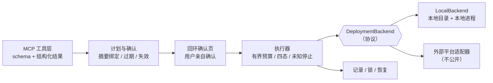

# MCP 项目公开化方案

> **决策已定（2026-11-11）：走"机制复刻"，不公开原版，也不做原版脱敏。** 这条规则已写入 [AGENTS.md](../AGENTS.md) 第 4 条，适用于所有内网项目。
> 时间：W11–W13（3 周），W15 投递（2027-02-22）。
> 前提：§1 的法律自查仍然要做——**复刻不改变"机制来自公司项目"这个事实**，对外表述要守住"个人独立复刻的实现"这个口径。

---

## 1. 两道必须先过的关

### 1.1 法律与合规（最高优先级，不过就不要往下做）

| 风险 | 说明 | 动作 |
|---|---|---|
| **职务作品归属** | 内网代码通常属职务作品，著作权归公司；"未上生产"不影响归属 | 查劳动合同的著作权条款；走一次内部开源/对外发布申请 |
| **保密义务** | 保密协议常覆盖"工作中产生的一切代码、文档、设计"，与是否上线无关 | 查保密协议范围；不确定就按"受约束"处理 |
| **竞业限制** | 若签过，公开同类工具可能被解读为竞品 | 查竞业条款的行业与业务范围 |
| **同事/第三方代码** | RuoYi 模板有第三方许可；若含他人代码，需单独确认 | 逐项核许可，第三方一律替换 |

> **结论**：如果拿不到明确授权，或者条款模糊——**不要公开原版**，走 §2 的路线 B（独立复刻）。这不是保守，是这类事的唯一稳妥解。

### 1.2 泄漏面清单（原版路线的必查项）

- **Git 历史**：161 次提交里可能残留早期的 `.env`、内网地址、账号、日志。**在原仓库里删文件是无效的**——历史里还在。必须新建空仓库。
- **配置文件**：平台地址、认证密钥路径、二维码应用 ID、对象存储端点与桶名、内网包索引地址、镜像仓库。
- **锁文件**：依赖锁里可能写死了内网源或公网绝对 URL。
- **资产**：截图/录屏里的域名、工位、内部系统界面；图片 EXIF。
- **文档**：65KB 验收记录里有真实环境描述；架构对比文档引用了内部平台能力。
- **代码本身**：模块命名、注释、错误码会暴露内部平台契约（签名方式、第三方登录、请求头约定）。
- **二进制/构建产物**：`dist/`、打包快照可能含配置。

---

## 2. 两条路线（已选 B，A 作废）

| 维度 | ~~A · 原版脱敏~~（**作废**） | **B · 机制复刻（已定）** |
|---|---|---|
| 做法 | 删敏感文件 + 换配置 + 重开历史 | 只保留核心机制，用假后端独立重写 2000–3000 行 |
| 工作量 | 40–60h | 30–40h |
| 泄漏风险 | 中：架构、命名、注释仍暴露内部设计 | 低：独立实现，无内部痕迹 |
| 法律风险 | **高**：本质是"复制公司代码后公开" | 低：属于你自己的实现 |
| 面试价值 | 高 | **高**：机制一样，还多一个"为什么重写"的回答 |

**为什么 A 作废**：脱敏只降低泄漏面，**不改变归属**。内网代码属职务作品，删掉地址和密钥之后，它仍然是公司资产。B 路线把"机制"和"实现"分开——机制是通用知识（可讲），实现是你自己的（可公开）。

---

## 3. 复刻版必须保留的 5 个机制（这才是卖点）

1. **计划—确认—执行三阶段**，确认内容绑定"账号 + 配置 + 产物摘要"，产物变化即失效；
2. **四态结果**（已受理 / 已运行 / 入口已生效 / 页面与版本已核验）+ **未知结果不重试**；
3. **确定性规则下沉**：资源上限、路径范围、摘要一致性用代码校验，不靠提示词；
4. **有界等待与预算**：单窗 + 总预算，耗尽返回 `await_user`，不无限轮询；
5. **本机记录 / 锁 / 恢复**：重启后保留原任务，等用户选择，不自动续跑。

> 这 5 条恰是面试官区分"写过 demo"和"做过系统"的地方。

---

## 4. 关键设计：可插拔后端

复刻版的核心结构是"把平台换成一个接口"——这本身就是架构能力的最佳展示：

协议只需 5 个方法：`prepare / publish / create / verify / describe`。

- `LocalBackend`：解压到本地目录、拉起进程、检测端口、请求首页核验——**完全离线可跑**，`make demo` 一条命令。
- 外部平台适配器**不公开**，但接口留在那，README 里说明"换实现即可对接其他平台"。

---

## 5. 三周计划（30–40h）

| 周 | 产出 | 验收 |
|---|---|---|
| **W11** | 目录骨架、`DeploymentBackend` 协议、`LocalBackend` 最小实现、`make demo` 能跑 | 一条命令起服务，`curl` 能调通 3 个工具 |
| **W12** | 计划/确认/执行三阶段 + 四态 + 未知停止 + 有界等待 + 记录恢复 | 单测覆盖：成功、拒绝、失败、未知、重启、重复调用 6 条路径 |
| **W13** | 测试补全、README（3 行 + 数字）、ADR × 5、架构图、1 分钟录屏、CI | `make demo` / `make test` 在干净机器可跑 |

**ADR 就写这几个**：为什么不用 FastMCP；为什么确认要绑定摘要；为什么未知结果不重试；为什么把平台抽象成接口；为什么本地 stdio 不做权限。

---

## 6. 发布前 checklist

- [ ] 新空仓库初始化（**不复用原历史**）
- [ ] 关键词扫描通过：内网域名 / IP / 公司名 / 人名 / 内部系统名 / 密钥前缀
- [ ] `git log --all` 无敏感提交；`git grep` 全历史扫一遍
- [ ] 依赖锁文件不含内网源与内网绝对路径
- [ ] 资产无截图/录屏泄漏，无 EXIF
- [ ] 文档全部重写（不搬内部验收记录）
- [ ] LICENSE 明确；README 顶部 3 行 + 数字
- [ ] 干净机器（或容器）`make demo` 一次通过
- [ ] CI 跑测试
- [ ] 已确认 §1.1 的授权结论

---

## 7. 与主计划的关系

这一项**替代原计划里的 P4「MCP 化」**（原为"从零写 5 个代码分析工具"）：
- 时间槽不变（W11–W13）；
- 产出从"一个玩具"变成"一个有真实机制的公开仓库 + 一个内网深度案例"；
- 内网案例的归档见 [01-内网建站MCP.md](internal/01-内网建站MCP.md)。
