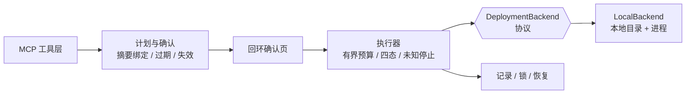

# MCP 项目公开化方案

> **决策（2026-11-11 已定）：走机制复刻，不公开原版、也不做原版脱敏。** 已写入 [AGENTS.md](../AGENTS.md) 第 4 条。
> 时间：W11–W13（3 周），W15 投递。原项目归档见 [internal/01-内网建站MCP.md](internal/01-内网建站MCP.md)。

---

## 1. 法律前置

| 风险 | 说明 | 动作 |
|---|---|---|
| **职务作品归属** | 内网代码著作权通常归公司；"未上生产"不影响归属 | 查合同条款 |
| **保密义务** | 常覆盖"工作中产生的一切代码、文档、设计" | 查保密协议范围 |
| **竞业限制** | 公开同类工具可能被解读为竞品 | 查竞业条款 |
| **第三方代码** | 模板含第三方许可（如 RuoYi） | 逐项核许可，一律替换 |

> **结论**：拿不到明确授权就不公开原版——但这不影响走复刻。复刻是**你自己的实现**，只借用了"机制"这种通用知识。

## 2. 为什么不用原版脱敏

脱敏只降低泄漏面，**不改变归属**。删掉地址和密钥后，代码仍是公司资产；而且架构、命名、注释仍会暴露内部设计。三个理由合起来：风险高、收益低、工作量还更大（40–60h vs 30–40h）。

## 3. 复刻必须保留的 5 个机制

1. **计划—确认—执行三阶段**：确认内容绑定"账号 + 配置 + 产物摘要"，产物一变即失效；
2. **四态结果**（已受理 / 已运行 / 入口已生效 / 已核验）+ **未知结果不重试**；
3. **确定性规则下沉**：资源上限、路径范围、摘要一致性用代码校验，不靠提示词；
4. **有界等待与预算**：单窗 + 总预算，耗尽返回 `await_user`；
5. **记录 / 锁 / 恢复**：重启保留原任务，等用户选择，不自动续跑。

> 这 5 条是面试官区分"写过 demo"和"做过系统"的地方。

## 4. 可插拔后端

协议只需 5 个方法：`prepare / publish / create / verify / describe`。`LocalBackend` 完全离线可跑，`make demo` 一条命令；外部平台适配器**不公开**，但接口留着，README 说明"换实现即可对接"。

## 5. 三周计划

| 周 | 产出 | 验收 |
|---|---|---|
| **W11** | 目录骨架、协议、`LocalBackend` 最小实现 | `curl` 调通 3 个工具 |
| **W12** | 三阶段 + 四态 + 未知停止 + 有界等待 + 记录恢复 | 单测覆盖成功/拒绝/失败/未知/重启/重复 6 条路径 |
| **W13** | 测试、README（3 行 + 数字）、ADR × 5、架构图、录屏、CI | 干净机器 `make demo` / `make test` 通过 |

**ADR 就写这 5 个**：为什么不用 FastMCP；为什么确认要绑定摘要；为什么未知结果不重试；为什么把平台抽象成接口；为什么本地 stdio 不做权限。

## 6. 发布前 checklist

- [ ] 新空仓库初始化（**不复用原历史**）
- [ ] 关键词扫描通过：内网域名 / IP / 公司名 / 人名 / 内部系统名 / 密钥前缀
- [ ] `git log --all` 与 `git grep` 历史均无敏感内容
- [ ] 依赖锁文件不含内网源与内网绝对路径
- [ ] 资产无截图/录屏泄漏，无 EXIF
- [ ] 文档全部重写（不搬内部验收记录）
- [ ] LICENSE 明确；README 顶部 3 行 + 数字
- [ ] 干净机器 `make demo` 一次通过；CI 跑测试
- [ ] §1 的授权结论已明确

## 7. 与主计划的关系

替代原 P4「MCP 化」：时间槽不变（W11–W13），产出从"一个玩具"变成"一个有真实机制的公开仓库 + 一份内网深度案例"。
