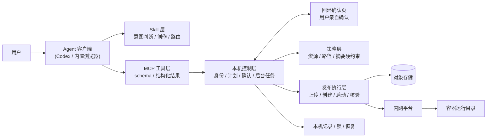

# 案例 A · 内网建站 MCP（脱敏）

> 来源：内网仓库 `sites-workbench`（外网备份），**已开发、已验收、未上生产**。
> 本文只写架构、决策与方法，**不含任何内部地址、账号、密钥、平台契约细节**。
> 用途：简历项目 A + 面试深聊素材。见[主规划 §11.2](../00-master-plan.md)。

---

## 1. 一句话定位

把"AI 写代码"和"把代码安全地发布到企业内网平台"接起来的 Agent 工具链：Skill 负责意图与创作，MCP 负责确定性校验、人工确认与受控发布。

## 2. 背景与规模（归一化）

| 维度 | 情况 |
|---|---|
| 业务场景 | 企业内网自建站点/工具页的交付链路，原本靠人工运维 |
| 痛点 | 手工部署易错、AI 直接操作平台不可控、失败后状态不明 |
| 产出形态 | MCP 服务（stdio）+ Skill + 项目模板 + 离线发布包 |
| 代码规模 | 主体 ~1.4 万行 Python / 70 个模块；测试 ~25 个文件 |
| 交付周期 | 14 天 / 161 次提交（含 AI 辅助编码） |
| 文档 | 15+ 篇设计参考、1 份按日期分版本的验收记录、1 份与外部同类产品的实现对比 |
| 上线状态 | **内网验收完成，未上生产**（面试必须如实说） |

## 3. 我的角色：独立负责全链路

**一句话**：调研分析 → 方案制定 → 开发 → 测试 → 交付文档，**全流程单人完成**。

| 阶段 | 我做的事 | 产出 |
|---|---|---|
| 调研分析 | 对比外部同类产品（Codex Sites）的实现思路，确定"AI 负责创作、程序负责发布"的分工 | 1 份实现思路对比文档（20KB） |
| 方案制定 | 定分层（Skill / MCP / 本机控制 / 发布执行）、定边界（哪些归代码管、哪些归平台管）、定状态与恢复策略 | 架构图 + 分层职责表 + 3 个关键决策 |
| 开发 | MCP 服务、Skill、项目模板、构建与发布脚本 | ~1.4 万行 Python / 70 模块 + Skill + 模板 |
| 测试 | 用例设计、离线回归、真实 stdio 验证、发布包校验 | ~25 个测试文件，覆盖成功/拒绝/失败/未知/重启/重复调用 |
| 交付 | 验收记录、构建文档、接入指南、发布说明 | 15+ 篇文档 + 65KB 按版本归档的验收记录 |

**这段经历在面试里的三个价值**：

1. **不是"接需求写代码"**，而是从 0 到 1 独立扛完一条有副作用的系统链路——方案是自己拍的，边界是自己定的；
2. **有取舍能力**：§5 的三个决策都是自己做的，且每个都否掉了一个看起来更省事的方案；
3. **有交付意识**：验收记录、边界声明（"本机通过 ≠ 内网实测 ≠ 容量保证"）、发布前校验，这些是"能上线"与"demo"的分界线。

**必须提前准备好的两个追问（诚实答，别硬扛）**：

| 追问 | 回答要点 |
|---|---|
| "1.4 万行 14 天，你手写的？" | 架构、约束边界、验收标准我定；编码用 AI 辅助，逐模块 review 并补测试。**别声称纯手写**——一追问模块细节就崩 |
| "一个人做会不会有盲区？" | 有。所以把不确定的部分写成显式边界（哪些验证过、哪些没验证、容量不作保证），而不是假装都验证过 |

## 4. 架构

| 层 | 职责 | 边界（不做什么） |
|---|---|---|
| Skill | 理解需求、选模板、写代码、解释结果 | 不承载确定性校验 |
| MCP 工具层 | 工具契约、结构化结果、下一步路由 | 不直接调平台 |
| 本机控制层 | 身份、计划摘要、人工确认、有界等待 | 不替用户做变更决策 |
| 策略层 | 资源上限、路径范围、摘要一致性、计划失效 | 不做权限（权限在平台） |
| 发布执行层 | 上传、创建、启动、入口与页面核验 | 不回传容器文件 |

## 5. 三个关键决策（含被否定的方案）

### 决策 1：确定性规则下沉到代码，而不是写进提示词

- **问题**：资源上限、路径范围、身份绑定、产物摘要、重复调用、计划失效——这些规则如果只写在 Skill 的提示词里，模型"忘了"就会出事。
- **选择**：全部下沉到 MCP 的代码里硬校验；Skill 只保留意图理解、创作和人工边界。
- **否定的方案**：在 Skill 里用自然语言写一长串"你必须…不要…"。
- **代价**：规则变更要改代码 + 补测试，不能靠改一句提示词。

> 面试价值：这是"Agent 工程化"的核心命题——**能用代码约束的，绝不用提示词**。

### 决策 2：变更必须由用户在本机浏览器亲自确认，且确认绑定摘要

- **问题**：让模型自己"确认"部署，等于没有确认。
- **选择**：先生成计划 → 用户在用回环页面确认 → 确认内容与"账号 + 配置 + 产物摘要"绑定 → 产物一变，计划立即失效。
- **否定的方案**：模型返回一个 `approved: true` 就执行；或"打开过页面"就算同意。
- **代价**：交互变重，必须处理"用户没确认""确认后断线""确认后产物变了"等分支。

> 面试价值：**人类审批不能是模型的布尔值**。这句话能讲清，说明真做过有副作用的 Agent。

### 决策 3：结果未知时不重试，保留原资产

- **问题**：超时后进行中的部署，究竟是成功还是失败？盲目重试会创建重复资源。
- **选择**：区分「请求已受理 / 容器已运行 / 入口已生效 / 页面与版本已核验」四个状态；结果未知时**停止并交给用户选择**，保留原服务而不重建。
- **否定的方案**：超时即重试、失败即换名重建、HTTP 200 即宣布成功。
- **代价**：需要本机状态记录、锁、恢复路径，代码量和交互复杂度都上升。

> 面试价值：这是分布式系统里的"未知结果"问题，能在 Agent 场景下讲清楚，是明显高于同龄人的信号。

### （可选）决策 4：用官方 MCP SDK，而不是 FastMCP

- **选择**：官方 SDK（低层 Server），自己控制 schema 与结果结构。
- **理由**：本地 stdio、需要严格的工具契约和结构化错误分类，装饰器式封装会挡住这些控制点。
- **代价**：样板代码更多。
- **注意**：这条和你原计划里写的"用 FastMCP"冲突，**以实际为准**，而且"为什么不用 FastMCP"本身就是个好答案。

## 6. 结果（工程指标，不是业务指标）

因为没有上线，**不能编业务数字**。可用的是工程证据：

| 维度 | 数字 |
|---|---|
| 主体代码 | ~1.4 万行 Python、70 个模块 |
| 测试 | ~25 个测试文件，覆盖成功/拒绝/失败/未知/重启/重复调用路径 |
| 交付节奏 | 14 天 161 次提交 |
| 设计资产 | 15+ 篇参考文档；1 份 65KB 按版本归档的验收记录 |
| 交互面 | 本地回环确认页（自有前端，约 50KB 资源） |
| 边界声明 | 明确标注"本机通过 ≠ 内网实测 ≠ 容量保证" |

> **诚实红线**：未上线就是未上线。简历写"完成内网验收的交付版"，不写"支撑 N 用户""上线运行"。

## 7. 踩过的坑

> **状态：待你口述后补写。** 这是面试最值钱的部分，我不能替你编。
>
> 口述时不用组织语言，按"当时发生了什么 → 为什么会这样 → 怎么查出来的 → 怎么改的 → 后来怎么防"随便讲，我负责整理成可讲的三条。
>
> 优先选这三类（面试官最爱听）：
> 1. **一个"以为成功其实失败"的坑**（结果判定/幂等）
> 2. **一个"改一处崩另一处"的坑**（耦合/边界）
> 3. **一个"文档写了但代码没做"的坑**（约束下沉不到位）

## 8. 如果重做会改什么

> ⚠️ **待你确认**。我的观察，供你参考：
> 1. 认证/存储/企微等平台适配散在多个模块，重做会把"平台适配层"抽成独立可替换接口（现在只有 `gateway.py` 预留）；
> 2. 计划/确认的状态机可以显式化成一张表，而不是散落在控制器分支里；
> 3. 验收记录按版本归档很好，但缺一份"一页纸的当前能力矩阵"。

## 9. 简历一句话 + 追问预演

**简历写法（两行）**：
> **独立负责**企业内网建站 Agent 工具链（MCP + Skill）从调研、方案、开发到验收的全链路：把 AI 创作与受控发布打通，下沉资源/路径/摘要等确定性约束，实现"计划—人工确认—发布—核验"四态可恢复流程；1.4 万行 Python，25 组测试覆盖成功/失败/未知路径。

**预演问答**：

| 追问 | 回答要点 |
|---|---|
| 为什么让 MCP 做而不是让 Agent 直接干？ | 模型擅长创作、不擅长保证不越界；资源上限、路径范围、摘要一致这些必须确定性执行 |
| 用户确认怎么做到不可绕过？ | 回环页 + 随机会话 + Host/Origin/CSRF 校验；确认内容绑定账号与产物摘要，产物变化即失效 |
| 超时了怎么办？ | 不重试。区分四种状态，保留原服务，等用户选择；宁可慢，不可重复创建 |
| 你和平台权限什么关系？ | 本机 stdio 无法对抗拥有本机控制权的用户，权限和配额必须由平台服务端实施——我们只做"防手滑"，不做"防恶意" |
| 有没有真上线？ | 没有。内网验收完成，未上生产。这是交付边界，我不夸大 |
| 1.4 万行是不是过度设计？ | 有争议。但其中约 1/3 是错误分类、状态恢复和测试，这部分恰恰是"能上线"和"demo"的差别 |

## 10. 公开化红线（如果要开源必须先处理）

| 必须剥离 | 说明 |
|---|---|
| 平台认证契约 | 内网平台的登录/签名/第三方登录接口，全部要换成假后端 |
| 企业微信扫码 | 换成通用 OAuth 或本地假登录 |
| 对象存储 | 内部端点与桶策略，换成 MinIO 本地或本地文件系统 |
| 内网源与镜像 | 内网包索引地址、内部镜像仓库，全部移除 |
| 内部模板 | 现用 RuoYi 模板要替换成自写的最小模板，避免第三方许可与内部定制混在一起 |
| 内部地址/账号/域名 | 配置样例、验收记录、截图里的全部清掉 |
| 作者与项目名 | 按需要决定是否保留 |

**结论**：这个仓库**不能直接公开**。要么只做内网案例（本文），要么花 40–60 小时重写一个"假后端"的瘦身版。
