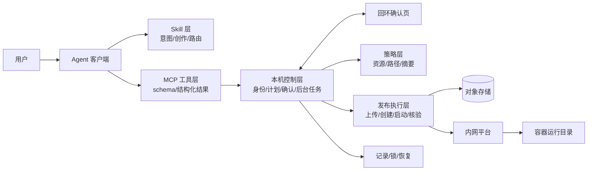

# 案例 A · 内网建站 MCP（脱敏）

> 来源：内网仓库 `sites-workbench`（外网备份）。**已开发、已验收、未上生产。**
> 只写架构、决策与方法，不含任何内部地址、账号、密钥、平台契约。

---

## 1. 一句话定位

把"AI 写代码"和"把代码安全地发布到企业内网平台"接起来的 Agent 工具链：Skill 负责意图与创作，MCP 负责确定性校验、人工确认与受控发布。

## 2. 规模

| 维度 | 情况 |
|---|---|
| 产出形态 | MCP 服务（stdio）+ Skill + 项目模板 + 离线发布包 |
| 代码 | ~1.4 万行 Python / 70 个模块；测试 ~25 个文件 |
| 周期 | 14 天 / 161 次提交（AI 辅助编码） |
| 文档 | 15+ 篇设计参考、按日期分版本的验收记录、1 份与外部同类产品的实现对比 |
| 上线状态 | **内网验收完成，未上生产**（面试必须如实说） |

## 3. 我的角色：独立负责全链路

调研分析 → 方案制定 → 开发 → 测试 → 交付文档，**全流程单人完成**。

| 阶段 | 产出 |
|---|---|
| 调研 | 对比外部同类产品的实现思路，定"AI 创作 / 程序发布"的分工 |
| 方案 | 分层（Skill / MCP / 本机控制 / 发布执行）、边界（代码管什么、平台管什么）、状态与恢复策略 |
| 开发 | MCP 服务、Skill、模板、构建与发布脚本 |
| 测试 | 用例设计、离线回归、真实 stdio 验证、发布包校验 |
| 交付 | 验收记录、构建文档、接入指南、发布说明 |

**追问预案**

| 追问 | 回答要点 |
|---|---|
| 1.4 万行 14 天，你手写的？ | 架构、约束边界、验收标准我定；编码 AI 辅助，逐模块 review 并补测试。**别声称纯手写** |
| 一个人做会不会有盲区？ | 有。所以把不确定的部分写成显式边界（哪些验证过、哪些没有、容量不作保证），而不是假装都验证过 |

## 4. 架构

| 层 | 职责 | 边界 |
|---|---|---|
| Skill | 理解需求、选模板、写代码、解释结果 | 不承载确定性校验 |
| MCP 工具层 | 工具契约、结构化结果、下一步路由 | 不直接调平台 |
| 本机控制层 | 身份、计划摘要、人工确认、有界等待 | 不替用户做变更决策 |
| 策略层 | 资源上限、路径范围、摘要一致性、计划失效 | 不做权限（权限在平台） |
| 发布执行层 | 上传、创建、启动、入口与页面核验 | 不回传容器文件 |

## 5. 三个关键决策

### 决策 1：确定性规则下沉到代码，不写进提示词

- **问题**：资源上限、路径范围、身份绑定、产物摘要、重复调用、计划失效，如果只写在 Skill 提示词里，模型"忘了"就出事。
- **选择**：全部下沉到 MCP 代码硬校验；Skill 只保留意图、创作和人工边界。
- **否定的方案**：在 Skill 里用自然语言写一长串"你必须…不要…"。
- **代价**：规则变更要改代码 + 补测试。

> 面试价值：**能用代码约束的，绝不用提示词。**

### 决策 2：变更必须由用户亲自确认，且确认绑定摘要

- **问题**：让模型自己"确认"部署，等于没有确认。
- **选择**：先生成计划 → 用户在用回环页面确认 → 确认与"账号 + 配置 + 产物摘要"绑定 → 产物一变，计划立即失效。
- **否定的方案**：模型返回 `approved: true` 就执行；或"打开过页面"就算同意。
- **代价**：交互变重，要处理"没确认 / 确认后断线 / 确认后产物变了"。

> 面试价值：**人类审批不能是模型的布尔值。**

### 决策 3：结果未知时不重试，保留原资产

- **问题**：超时的部署究竟成功还是失败？盲目重试会创建重复资源。
- **选择**：区分「请求已受理 / 容器已运行 / 入口已生效 / 页面与版本已核验」四态；未知时停止并交给用户，保留原服务不重建。
- **否定的方案**：超时即重试、失败即换名重建、HTTP 200 即宣布成功。
- **代价**：需要本机状态记录、锁、恢复路径。

> 面试价值：分布式系统的"未知结果"问题，在 Agent 场景下讲清楚是明显高于同龄人的信号。

### （附）决策 4：用官方 MCP SDK，不用 FastMCP

本地 stdio、需要严格工具契约与结构化错误分类，装饰器式封装会挡住控制点。代价是样板代码更多。**注意**：这与原规划写的"用 FastMCP"冲突，以实际为准，且"为什么不用 FastMCP"本身就是好答案。

## 6. 结果（工程指标，不是业务指标）

未上线，**不能编业务数字**。可用的是：~1.4 万行 / 70 模块；~25 个测试文件覆盖成功、拒绝、失败、未知、重启、重复调用；14 天 161 次提交；15+ 篇设计文档；本地回环确认页约 50KB 资源。

> **诚实红线**：未上线就是未上线。简历写"完成内网验收的交付版"，不写"支撑 N 用户"。

## 7. 踩过的坑

> **状态：待口述后补写。** 按"发生什么 → 为什么 → 怎么查出来 → 怎么改 → 后来怎么防"随便讲，我整理成三条。
>
> 优先选：① 以为成功其实失败（结果判定/幂等）② 改一处崩另一处（耦合/边界）③ 文档写了但代码没做（约束下沉不到位）。

## 8. 如果重做会改什么

> 待确认。参考观察：① 平台适配散在多个模块，应抽成独立可替换接口；② 计划/确认状态机可显式化成一张表；③ 验收记录按版本归档很好，但缺一页"当前能力矩阵"。

## 9. 简历一句话

> **独立负责**企业内网建站 Agent 工具链（MCP + Skill）从调研、方案、开发到验收的全链路：把 AI 创作与受控发布打通，下沉资源/路径/摘要等确定性约束，实现"计划—人工确认—发布—核验"四态可恢复流程；1.4 万行 Python，25 组测试覆盖成功/失败/未知路径。

## 10. 公开化

**结论（2026-11-11 已定）**：仓库不公开，也不做原版脱敏。公开产出走**机制复刻**，方案见 [02-mcp-open-source.md](../02-mcp-open-source.md)。
