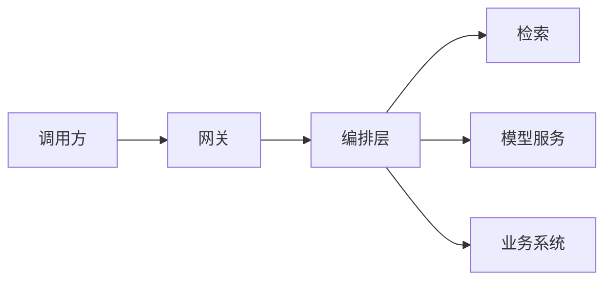

# 内网项目脱敏归档

> 这里存放**不能公开代码、但可以讲**的内网项目案例。
> 原则：**只讲架构、决策与归一化指标，不贴代码、不贴数据、不写内部系统名与客户名。**
> 目的：让 1.5 年真实生产经验变成简历与面试里可讲的故事（见 [主规划 §11.2](../00-master-plan.md)）。

---

## 为什么需要这份归档

1. 你的核心资产是**真实约束下的交付经验**，开源仓库替代不了它；
2. 面试官会问"你之前做的和这些 demo 有啥区别"——这份文档就是答案；
3. 写下来才能发现"哪块其实我没想清楚"，这比背八股有用。

## 脱敏红线（写之前先读）

| 绝对不能写 | 替代写法 |
|---|---|
| 客户名 / 供应商名 | "某主机厂内部系统" |
| 内部系统代号、域名、IP | "业务网关" / "检索服务" |
| 真实数据样例、字段名 | "结构化工艺参数" / "用户会话文本" |
| 精确内部指标 | "约 / 量级 / 相对提升 30% / 下降到原来的 1/3" |
| 可反推业务的细节 | 抽象成通用技术问题 |
| 任何代码片段 | 画框图 + 文字描述接口契约 |

> 拿不准的一律不写。**宁可少一个数字，不要多一个麻烦。**

---

## 模板（每个项目复制一份，存为 `NN-项目名.md`）

````markdown
# 项目名（脱敏代号）

## 1. 一句话定位
用一句话说清：这是什么系统，解决谁的什么问题。

## 2. 背景与规模（归一化）
- 业务场景：
- 规模：日调用量 / 数据量 / 用户量（用"万级/千级"量级表述）
- 原方案与痛点：
- 为什么需要 AI / 为什么原来的方式不行：

## 3. 我的角色
- 独立负责 / 主导 / 参与者（诚实）
- 我具体负责的模块：
- 团队规模与协作方式：

## 4. 架构
（一张 mermaid 框图，脱敏）



关键模块职责：
| 模块 | 职责 | 边界（不做什么） |
|---|---|---|

## 5. 三个关键技术决策（含被否定的方案）
### 决策 1：
- 问题：
- 选择：
- 否定掉的替代方案 & 原因：
- 代价（付出了什么）：

### 决策 2 / 3：同上

## 6. 结果（4 个数字）
| 维度 | 改造前 | 改造后 | 说明 |
|---|---|---|---|
| 效果 |  |  | 准确率 / 采纳率 / 人工介入率 |
| 成本 |  |  | 每千次调用的 token / 费用 |
| 延迟 |  |  | P50 / P95 |
| 稳定性 |  |  | 可用率 / 失败率 |

## 7. 踩过的坑（最有价值的部分）
1. 现象 → 根因 → 怎么定位 → 怎么修 → 学到了什么
（至少 3 条，越具体越好）

## 8. 如果重做会改什么
（面试官必问，答得好能拉开差距）

## 9. 可对外讲的一句话 + 追问预演
- 简历一句话：
- 可能被追问的 5 个问题 & 我的回答要点：
````

---

## 已归档

| 编号 | 项目代号 | 状态 | 简历可用 |
|---|---|---|---|
| A | 内网建站 MCP（`sites-workbench` 外网备份） | 架构 / 决策 / 角色已归档；**踩坑待口述** | ✅ 作为项目 A |
| —— | 待投喂 | —— | —— |

## 投喂方式

按上面模板写草稿（口语化、想到什么写什么都行），直接发给我，我负责：
1. 结构化成可讲的故事；
2. 抽出"4 个数字"；
3. 补追问预演；
4. 检查脱敏红线。
